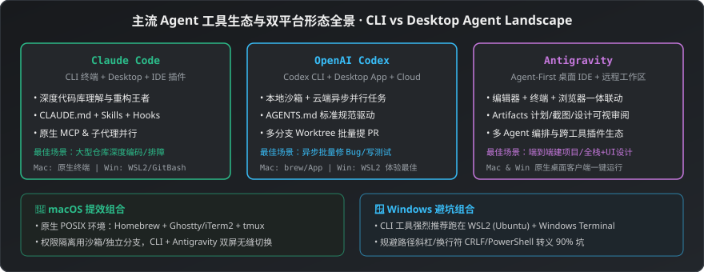


- **2026 三大主力已全部实现「CLI + 桌面软件」双形态**：**Claude Code（`claude`）**、**OpenAI Codex（`codex`）**、**Google Antigravity（`agy` CLI + App + IDE + 7 大编辑器插件）**。
- **CLI** 胜在贴近终端、可脚本化（无头批处理）与多窗并行；**桌面端** 胜在可视 Diff、浏览器联动、截图视觉迭代与非编码办公。
- **最佳实践是组合拳**：终端高频干活随时用 **`agy` / `claude` / `codex`**；全栈/UI 设计看预览切 **Antigravity App/IDE**；异步批量修 Bug/补测试丢给 **Codex**。




## 1. 三大主力 Agent 怎么选？一张表定乾坤 / Choosing Between Claude Code, Codex & Antigravity


别盲目追新，看清每款工具的**主战场与形态**，按任务派活才最高效：



All three leading ecosystems now ship both terminal CLIs and desktop surfaces. Match each tool to its strongest lane:


| 工具 Tool | 形态 Form Factor | 核心规范文件 Rules File | 最强杀手锏 Superpower | 最适合的场景 Best For |
| :--- | :--- | :--- | :--- | :--- |
| **Claude Code** | CLI (`claude`) + Desktop + IDE 插件 | `CLAUDE.md` / `AGENTS.md` | 深度代码库理解、Hooks、Skills、按需子代理隔离 | 大型仓库深度重构、疑难 Bug 根因定位 |
| **OpenAI Codex** | CLI (`codex`) + Desktop App + Cloud | `AGENTS.md` | 本地沙箱 + 云端异步并行任务、Worktree 批量提 PR | 后台刷单测、批量修 Issue、多分支实验 |
| **Google Antigravity** | **CLI (`agy`)** + App + IDE + 7 IDE 插件 + Python SDK | `AGENTS.md` + Rules + Skills | **`agy` 单编译二进制（零 Node/Python 依赖）**、单终端多模型、`/plan` `/grill-me` `/goal` `/diff`、桌面端联动浏览器与 Artifacts | 端到端全栈建项、终端+视觉预览联动、多模型切换与办公自动化 |

## 2. Antigravity CLI (`agy`) 速查：为什么它特别顺手？ / Antigravity CLI (`agy`) Quick Reference


很多同学只知道 Antigravity 有桌面 App 和 IDE，其实它的官方终端客户端 **Antigravity CLI（命令 `agy`）** 与桌面端共享同一套 Agent Harness，有三个极大提效亮点：
1. **单编译二进制，零运行时依赖**：不需要提前装 Node.js 或 Python，macOS、Linux、Windows（PowerShell/CMD）均支持**一行命令直接安装**。
2. **一终端切换多模型家族**：支持 Gemini、Claude 等多系列模型（视订阅计划），并支持从 Claude Code / Codex / Cursor 一键导入已有的 MCP、Skills 与规则。
3. **内置高阶工程斜杠命令与快捷审阅**：
   - `agy` 启动交互式 TUI；`agy -i "任务"` 带初始提示启动；`agy -p "任务"` **无头单次运行（极适合写进 Shell/CI 脚本）**。
   - 交互内按 **`Shift + Tab`** 切换执行模式（`plan` / `default` / `accept-edits` / `auto`）；按 **`Ctrl + R`** 直达 Artifact 审阅页看计划和 Diff；常用 `/plan`、`/grill-me`（开工前先访谈对齐需求）、`/goal`、`/diff`、`/compact`、`/agents`。



**Antigravity CLI (`agy`)** shares the exact same agent harness as the Antigravity App and IDE, shipping as a **single compiled binary with zero Node/Python runtime dependencies**:
- Launch with `agy` (interactive TUI), `agy -i "prompt"` (pre-filled interactive), or `agy -p "prompt"` (headless non-interactive mode for scripts/CI).
- Press **`Shift + Tab`** to toggle modes (`plan`, `default`, `accept-edits`, `auto`), **`Ctrl + R`** for Artifact Review, and use built-in slash commands like `/grill-me`, `/plan`, `/goal`, `/diff`, `/compact`, and `/agents`.


## 3. macOS vs Windows 双平台极速安装（不踩坑版） / macOS & Windows Setup

### 🍎 macOS / Linux 一键安装 / macOS & Linux

```bash
# 1. 基础高速工具链（装齐后，所有 Agent 搜代码、看 PR、管 Python 快 5 倍）
# macOS: brew install ripgrep jq gh uv node
# Linux: sudo apt install -y ripgrep jq gh && curl -LsSf https://astral.sh/uv/install.sh | sh

# 2. 安装三大 CLI Agent（按需任选）
curl -fsSL https://antigravity.google/cli/install.sh | bash   # Antigravity CLI (agy，单二进制零依赖)
npm install -g @anthropic-ai/claude-code                      # Claude Code CLI (claude)
npm install -g @openai/codex                                  # OpenAI Codex CLI (codex)

# 3. 验证就绪
agy --version && gh auth status
```

### 🪟 Windows 双轨方案（原生 + WSL2 避坑指南） / Windows Setup


Windows 用户记住两条核心经验，直接避开 90% 路径反斜杠与 PowerShell 转义坑：
1. **原生极速通道（无需 WSL 也能直接跑）**：
   - **Antigravity App / IDE** 直接下载 Windows `.exe` 原生安装；
   - **Antigravity CLI (`agy`)** 在 PowerShell 中一行即可原生安装到 `%LOCALAPPDATA%\agy\bin`（免管理员权限）：
     `irm https://antigravity.google/cli/install.ps1 | iex`
2. **重度开发仓库推荐通道（WSL2 Ubuntu + Windows Terminal）**：
   - 跑大量 Linux/Bash/Node/Python 项目的仓库，强烈建议把代码放进 **WSL2 的 `~/projects/`**（**切忌放 `/mnt/c/`**，跨盘 I/O 慢 10 倍），在 WSL2 内运行 `agy`、`claude`、`codex`，桌面端 Antigravity/VS Code 通过 Remote WSL 直连。
   - 若在原生 Windows 下协作 Git，务必执行 `git config --global core.autocrlf input` 防止换行符污染 Diff。



On Windows, you have two clean paths:
1. **Native fast path**: Install **Antigravity App/IDE** natively and install **Antigravity CLI (`agy`)** right in PowerShell with `irm https://antigravity.google/cli/install.ps1 | iex` (zero runtime dependencies, no admin needed).
2. **Heavy Linux/POSIX repos**: Put repositories inside **WSL2 (`~/projects/`, never `/mnt/c/`)** and run `agy`, `claude`, or `codex` in Windows Terminal for native Unix speed and zero path/CRLF friction.


## 4. 权限模式与安全边界：既要快、又要稳 / Permission Modes: Fast Yet Safe

| 操作级别 Risk Level | 典型命令 Examples | 推荐权限策略 Recommended Policy |
| :--- | :--- | :--- |
| 🟢 **只读探索** | `ls`, `rg`, `git status`, `git diff`, 读文件 | **自动放行**（减少无意义确认打断心流） |
| 🟡 **本地可逆写操作** | 改代码、跑 `pytest` / `npm test`、本地 `git commit` | **沙箱内自动放行**（在功能分支随时可回滚） |
| 🔴 **不可逆 / 外部影响** | `rm -rf`, `git push --force`, 删库、发邮件、改生产配置 | **永远保持人工审批（Ask Before Run）** |


在项目根目录维护一份**极简 `AGENTS.md`**（Claude Code 可用 `ln -s AGENTS.md CLAUDE.md` 软链复用），这样不管你今天切 `agy`、`claude`、`codex` 还是桌面 IDE，**所有 Agent 自动遵守同一套项目铁律**！


## 5. 官方文档与下载地址 / Official Links

- 🚀 **Google Antigravity Docs (App / CLI `agy` / IDE / SDK)**: [Get Started with Google Antigravity](https://antigravity.google/docs/getting-started/) · [Antigravity CLI GitHub](https://github.com/google-antigravity/antigravity-cli)
- 📘 **Claude Code Docs**: [Anthropic Claude Code Overview](https://docs.anthropic.com/en/docs/claude-code/overview)
- 📗 **OpenAI Codex**: [OpenAI Codex CLI (GitHub)](https://github.com/openai/codex)
- 🪟 **Microsoft WSL2**: [Install WSL2 on Windows](https://learn.microsoft.com/en-us/windows/wsl/install)
