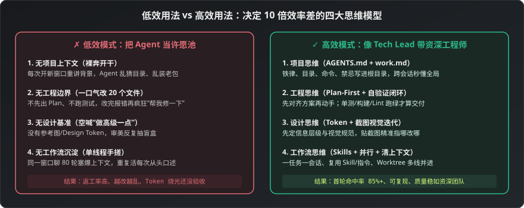


把 Agent 当成**刚入职但执行力极强的资深工程师**：他聪明、手速快、能连干 10 小时，但**他不是你肚子里的蛔虫**。你给的上下文、边界、验收标准越清晰，他交付得越像大师。




## 1. 决定 10 倍效率差的四大思维 / The 4 Mindsets Behind 10× Leverage


1. **项目思维（Project Mindset）**：不再把任务当成孤立的“写一段代码”，而是始终维护**项目级全局记忆**——在根目录放极简 `AGENTS.md`（通用铁律、构建命令、禁忌）和 `work.md`（当前进度、架构索引、踩坑记录），让任何新会话 10 秒进入状态。
2. **工程思维（Engineering Mindset）**：**Plan-First（先方案后编码）+ 小步原子改动 + 确定性验证闭环**。绝不相信模型口头说“我已经修好了”，必须让它跑通测试、Lint、编译或抓包验证才算验收。
3. **设计思维（Design Mindset）**：做界面、文档或产品前，先对齐**用户路径、信息层级与视觉基准（参考图 / 色板 / 间距规范）**，再通过“生成 → 截图 → 精准指哪改哪”迭代，而不是模糊吐槽“再高级一点”。
4. **工作流思维（Workflow Mindset）**：凡是每周重复超过 2 次的操作（写周报、Code Review、发版、建新专栏），立刻封装成 **Skill / Slash Command / 自动化脚本**；长会话及时清空上下文（`/clear` 或开新窗口），用多任务并行代替干等。



1. **Project Mindset**: Externalize project memory into a crisp `AGENTS.md` (invariants, build commands, off-limits paths) and `work.md` (status, architecture map, pitfalls) so every fresh session starts at full speed.
2. **Engineering Mindset**: **Plan first**, make small reviewable diffs, and demand **deterministic verification** (tests, lint, build exit code `0`)—never accept "looks good now" without proof.
3. **Design Mindset**: Lock in user flow, hierarchy, and visual tokens/references *before* coding UI, then iterate via concrete visual screenshots instead of vague adjectives.
4. **Workflow Mindset**: Turn any recurring task done twice into a reusable **Skill / Slash Command / script**; keep sessions short and focused, and parallelize independent tasks.


## 2. 十组硬核对比：低效用法 vs 高效用法 / 10 Concrete Contrasts: Slow vs. Fast

| 场景 Scenario | ❌ 低效用法（踩坑重灾区） | ✅ 高效用法（立竿见影提效） | 背后思维 Mindset |
| :--- | :--- | :--- | :--- |
| **1. 下达需求** | “帮我做一个登录页面，要好看一点。” | “参考现有暗色主题 `#1d1f21` + `#2bbc8a`，在 `src/pages/Login.tsx` 实现邮箱+密码登录，含表单校验、加载态与错误提示；先给 5 行计划再动手。” | 设计 + 工程思维 |
| **2. 保护旧代码** | 改完才发现 Agent 顺手把老文件全格式化重命名了 | 在 `AGENTS.md` 写明禁区：“严禁修改 `source/_posts/` 与历史迁移脚本”，交付前自跑 `git diff --stat` 核验 | 项目思维 |
| **3. 排查 Bug** | “报错了，帮我修一下”（只发一句情绪） | 直接粘贴**完整报错栈 + 复现命令 + 预期行为**，要求：“先定位根因，写一个复现失败单测，再修至测试全绿” | 工程思维 |
| **4. 处理大任务** | 一句话让 Agent 一次性从零重构整个后端 30 个文件 | 拆成 3 个可验证里程碑（Schema → API → 前端联调），每步跑通测试并 `git commit` 存档 | 工程思维 |
| **5. 上下文管理** | 一个聊天窗口从早聊到晚 80 轮，Agent 开始胡言乱语 | **一任务一会话**！做完一个模块更新 `work.md`，开全新会话轻装上阵（或用 `/compact` 压缩） | 工作流思维 |
| **6. 调 UI 审美** | “感觉怪怪的，再大气高端一点” | 贴上当前页面截图：“1) 标题和副标题间距拉大到 12px；2) 卡片边框减弱为 `#363b42`；3) 移动端改为单列” | 设计思维 |
| **7. 接外部数据** | 手动复制 10 个网页和日志粘贴进输入框 | 配好 MCP / CLI（`gh`、`curl`、数据库只读工具），让 Agent 自己抓一手数据并核验 | 工作流思维 |
| **8. 代码审查** | Agent 改完直接无脑点 Accept All 推上线 | 开一个**独立新会话**扮演严苛 Reviewer，专门审查 `git diff` 找边界条件、安全漏洞与冗余代码 | 工程思维 |
| **9. 跨会话交接** | 第二天换一台电脑或新对话，花 15 分钟重新解释项目 | 每次收工让 Agent 自动更新 `work.md`，新会话第一句只需说：“先读 `AGENTS.md` 和 `work.md`，继续做第 3 项” | 项目思维 |
| **10. 重复性办公** | 每周五手写 300 字 Prompt 让 AI 总结 Git 提交写周报 | 沉淀成一个 `weekly-report` Skill，每周五输入一句话，自动拉 `git log` 按模板生成双语周报 | 工作流思维 |

## 3. 万能高命中率指令公式（复制即用） / Universal High-Hit-Rate Prompt Pattern

```text
[目标] 我要在 <具体路径/模块> 实现 <一句话核心结果>。
[背景] 先阅读 AGENTS.md、work.md 以及 <关键参考文件>。
[约束] 1. 不要改动 <禁区文件>；2. 复用现有样式/工具函数；3. 保持极简。
[流程] 先输出 5~8 行实施计划，确认无误后执行；完成后运行 <测试/构建命令> 验证全绿，并更新 work.md。
```


当你在同一个会话里反复试错 5 轮以上时，前面失败的思路和废代码仍留在上下文里，会持续把模型“带沟里”。**一旦发现 Agent 连续两轮越改越乱：立刻停下，回滚脏改动（`git checkout -- .`），把真正有用的结论浓缩成 5 行，开一个全新会话重来——3 分钟就能秒解之前卡 1 小时的死胡同！**

