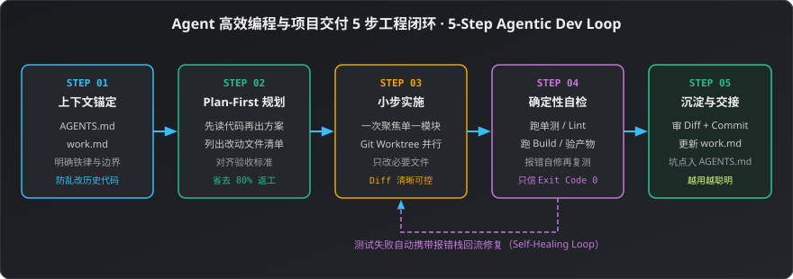


**写代码的时间已经趋近于零，真正昂贵的是“方向偏了”和“线上炸了”。** 用 10% 的时间做规划与定验收标准，把 90% 的执行与自检交给 Agent。




## 1. 给项目装上“外置大脑”：极简 `AGENTS.md` + 动态 `work.md` / External Project Memory


很多人的 `AGENTS.md` 写得像 3000 字长篇小说——**大错特错！** 太长反而稀释注意力、浪费每轮 Token。真正顶级的 `AGENTS.md` 不超过 **40 行**，只写 Agent 猜不到的硬信息：
- **构建与测试命令**（精确到参数，如 `uv run pytest -q`、`npm run build`）
- **目录禁区与代码规范**（哪些文件严禁改动、优先复用哪个模块）
- **血泪踩坑备忘**（每次被某个坑绊倒一次，就用 1 行记入 `AGENTS.md`，从此全项目免疫！）

而**动态状态**（当前任务 Checklist、架构索引、遗留问题）全部放进 `work.md`，形成“**静态规则看 `AGENTS.md` + 动态进度看 `work.md`**”的双文件黄金搭档。



Keep `AGENTS.md` razor-thin (<40 lines)—only write non-obvious invariants: exact build/test commands, off-limits files, and one-line lessons learned from real bugs. Store live checklists and session handoff state in `work.md`.


```markdown
# AGENTS.md (30 行黄金模板)
## Stack & Commands
- Backend: Python 3.12 + FastAPI (`uv run pytest -q`, `uv run ruff check .`)
- Frontend: Vite + React (`pnpm build`, `pnpm typecheck`)

## Hard Rules
1. Never edit `migrations/legacy/` or existing API v1 response schemas.
2. Every bug fix must add a failing regression test first.
3. Run tests + typecheck before reporting done; update `work.md` after every task.

## Gotchas
- Local PG runs on port 5433 (not 5432); see `.env.example`.
```

## 2. 确定性自验证闭环：让 Agent 自己当自己的 QA / Deterministic Self-Verification


有没有验证环境，直接决定了 Agent 是“玩具”还是“生产力核武器”。下达任务时，务必给它一个**机器可判定的验收命令**：
- **后端 / 算法**：`pytest` 单测 + `ruff`/`mypy` 静态检查
- **前端 / 静态站**：`npm run build` + 自写 10 行脚本检查零空文件、零坏链、零断图
- **接口联调**：起本地服务后用 `curl -sf http://localhost:8000/health` 实测返回码与 JSON 结构
- **端到端 UI**：用 Playwright 无头浏览器自动点一遍核心流程并截屏验视

一旦测试挂了，Agent 会自动读报错栈 → 定位根因 → 修改代码 → 重跑验证，整个修复闭环往往无需你插手！



Always attach a machine-checkable exit condition (`pytest`, `tsc --noEmit`, `curl`, Playwright smoke test, or static link checker). When a check fails, the agent reads the exact traceback and self-heals until exit code `0`.


## 3. 进阶倍增器：Git Worktree 并行多 Agent 作战 / Parallel Agents with Git Worktrees


还在傻傻盯着一个 Agent 跑完 3 分钟再提下一个需求？高手早已用 **Git Worktree** 同时开 2~3 个隔离工作目录，让多个 Agent **互不干扰地并行干活**：
- 终端 1（Claude Code）：在 `../repo-feat-auth` 开发 OAuth 登录模块
- 终端 2（Codex）：在 `../repo-fix-tests` 补齐订单服务的单元测试
- 桌面端（Antigravity）：在主目录打磨前端仪表盘 UI 与预览截图

每个目录共享同一个 `.git` 对象库（几乎零磁盘冗余），却拥有各自独立的分支和文件树，干完直接分别提 PR 合并！



Stop working single-threaded. Use `git worktree` to spin up isolated directories on separate branches so Claude Code, Codex, and Antigravity execute independent tasks in parallel without stepping on each other's files:


```bash
# 从主仓库秒建两个隔离分支工作区（共享 Git 历史，互不冲突）
git worktree add ../myapp-auth feat/oauth-login
git worktree add ../myapp-tests test/order-coverage

# 分别在不同终端/软件打开两个目录并行派活，合并后清理：
git worktree remove ../myapp-auth
```

## 4. 真实排障套路：三句话搞定顽固 Bug / 3-Step Bug Crushing Protocol


遇到棘手 Bug 时，按这三步指挥 Agent，命中率近乎 100%：
1. **先复现，不许瞎猜**：*“先不要改业务代码，写一个最小复现脚本/单测，证实你能稳定复现这个报错。”*
2. **二分定位根因**：*“基于复现结果检查调用链，列出最可能的 2 个根因并用日志/断言证实真正的那个。”*
3. **最小变更修复 + 回归**：*“用最小改动修复根因，确保新单测和全量旧测试全部通过，给出 `git diff` 摘要。”*



For stubborn bugs, enforce this 3-step loop: (1) write a minimal failing repro test *before* editing app code, (2) verify the root cause with evidence rather than guessing, and (3) apply the smallest fix and run the full regression suite.

