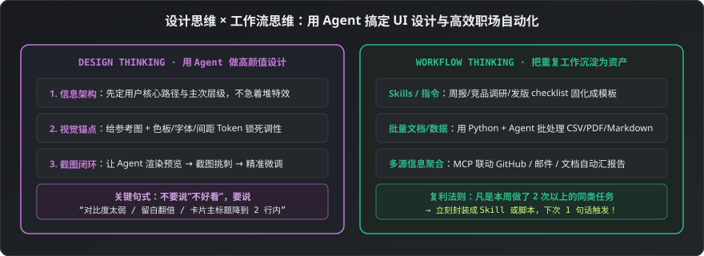


Agent 最被低估的不是“写代码”，而是**用代码和工具作为杠杆去解决非编程工作**——画高清矢量图、批量清洗百份文档、跨工具汇总周报、快速出交互式高保真原型。




## 1. 用设计思维告别“廉价 AI 模板味” / Escaping Generic "AI Slop" in Design


很多人让 Agent 做网页或 PPT，结果出来全是千篇一律的“紫蓝渐变 + 密密麻麻卡片 + 刺眼 Emoji”。问题不在模型，而在你没给**设计锚点**。

**高颜值设计 4 步法（尤其适合 Antigravity 等带预览能力的工具）**：
1. **先定信息架构（IA）**：写清这个页面只有哪 1 个核心动作、视觉焦点排第几，砍掉一切多余装饰。
2. **锁死 Design Tokens**：直接给出精确数值——底色、表面色、强调色、字体栈、最大行宽、圆角与留白节奏（例如 *“极简暗色 `#1d1f21` + 单一翠绿强调色 `#2bbc8a` + 无多余阴影”*）。
3. **用代码生成矢量图（SVG）与交互原型**：技术架构图、数据可视化直接让 Agent 写干净的 SVG 或单文件交互 HTML，比盲抽位图精准 10 倍、字迹永不糊。
4. **视觉截图闭环（Visual Critique）**：把渲染出来的页面截屏喂回去，用**可测量词汇**精准微调（如“主标题字号从 24px 提到 30px”、“表格单元格左右内边距加到 14px”、“删掉底部冗余角标”）。



To avoid generic "AI slop" layouts, always give concrete design anchors: (1) define a single primary user action, (2) lock exact Design Tokens (palette, typography, spacing scale), (3) prefer clean SVG/interactive HTML prototypes for precision, and (4) iterate via real screenshots with measurable adjustments.


## 2. 高频职场工作流：从“手动复制粘贴”到“一句话批处理” / High-Leverage Knowledge Work

| 办公场景 Work Task | ❌ 传统低效方式 | ✅ Agent 工作流方式（提效 5~10×） |
| :--- | :--- | :--- |
| **竞品 / 行业深度调研** | 自己开 30 个标签页翻半天再拼 Word | 让 Agent 并行检索一手官方源 → 核验日期与 URL → 输出结构化对比矩阵表 + 结论摘要 |
| **处理 50 份 PDF / CSV 报表** | 手动逐个打开复制进 Excel 汇总 | 让 Agent 写一段 20 行 Python 脚本批处理全部文件、生成清洗后 CSV 与可视化图表 |
| **周报 / 复盘 / 技术方案** | 对着空白文档憋 2 小时 | 给 Agent `git log` + 本周会议纪要 + 固定模板，先出提纲对齐再成文，10 分钟定稿 |
| **跨平台信息协同** | 在 GitHub、邮件、文档间来回切换搬运 | 通过 MCP / 插件直连 GitHub、Gmail、云文档，自动拉取待办、汇总进展并起草回复草稿 |

## 3. 工作流复利：把好套路封装成 Skills / Compound Your Workflows into Skills


**职场与工程的终极分水岭是“复利”**：当你打磨出一套特别顺手的流程（例如：*如何写一篇双语技术专栏并校验链接*、*如何做每日 AI 热点核验*、*如何按公司规范审查 PR*），千万别让它沉睡在聊天记录里！

把它写成一份简短的 `SKILL.md`（触发条件 + 固定步骤 + 检查清单 + 输出模板）：
- **Claude Code**：放进 `.claude/skills/<name>/SKILL.md` 或 `.claude/commands/`
- **Codex / Antigravity**：放进项目技能目录或通过全局 Skill 管理保存

下一次遇到同类工作，你不再需要写 500 字解释要求，只需输入一句触发词（或 `/skill-name`），Agent 立刻严格按你的最高标准执行！



Whenever you refine a repeatable workflow (PR reviews, daily news digests, release checklists, bilingual blog publishing), crystallize it into a reusable `SKILL.md` or Slash Command. Next time, a single short trigger runs your best standard operating procedure automatically.


```markdown
<!-- 示例：极简可复用工作流 Skill 结构 -->
---
name: weekly-tech-digest
description: 汇总本周 Git 提交与关键进展，输出极简高管/团队双语周报
---
1. 运行 `git log --since="7 days ago" --oneline` 与 `work.md` 变更。
2. 按「核心交付 / 关键指标 / 风险与下周计划」三段提炼，总字数不超过 400 字。
3. 严禁流水账，每条必须写清业务或工程结果。
```
