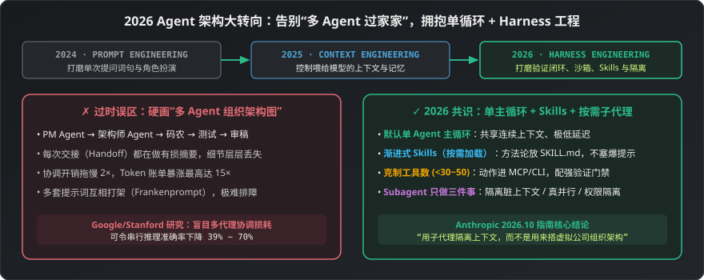


**风向确实大变了，但不是“禁止用多 Agent”，而是彻底告别 2024–2025 年那种“给每个角色建一个 Agent 互相聊天”的过家家架构！**

2026 下半年的行业铁律变成了两句话：
1. **默认「单 Agent 主循环 + 渐进式 Skills + 精简工具」优先**；
2. **派 Subagent（子代理）的唯一正当理由是「隔离上下文噪声 / 真正并行 / 权限隔离」，而不是按人类部门画组织架构图。**


## 1. 为什么 2026 年大家开始“给多 Agent 降温”？ / Why the Industry Cooled on Multi-Agent Org Charts


2024–2025 年，全网教程都在画酷炫的“AI 虚拟公司”：一个产品经理 Agent 写完文档丢给架构师 Agent，再丢给前端/后端 Agent，最后丢给测试 Agent——图画得极好看，**一进生产就翻车**：

- **交接失真（Lossy Handoff）**：每多一层 Agent 转手，中间推理细节就要被压缩成摘要，传三手后彻底跑偏。
- **性能不升反降**：Google 与 Stanford 的实证研究指出，盲目引入多 Agent 协调层会让串行复杂推理表现**暴跌 39% ~ 70%**，Token 消耗却可能飙升至单 Agent 的 **~15 倍**！
- **模型变强了，旧胶水成了累赘**：2026 年的新一代前沿模型已能在一个连续上下文里自己完成规划、调用工具与修正路线。Anthropic 在 **2026 年 10 月**发布的重磅实战指南（*When to fold subagents into your main agent loop*）中披露：把冗余子代理折叠回单主循环后，有客户实测端到端运行速度直接快了 **~2 倍**、语气与全局一致性大幅提升。



In 2024–2025, everyone drew elaborate "AI org charts" (PM Agent → Architect Agent → Coder Agent → QA Agent). In production, those chains failed hard:
- **Lossy handoffs** dropped crucial nuance at every agent boundary.
- **Coordination tax**: Studies from Stanford and Google showed multi-agent coordination overhead can cut sequential reasoning accuracy by **39%–70%** while burning up to **~15× more tokens**.
- **Anthropic's Oct 2026 guidance** (*When to fold subagents into your main agent loop*) formalized the reversal: modern models can plan inside one continuous loop—folding unnecessary specialist subagents back into one loop made a real customer workflow **~2× faster** with higher end-to-end quality.


## 2. 什么时候折叠成一个，什么时候必须派 Subagent？ / Fold vs. Keep: The 2026 Decision Matrix

| 判断维度 Dimension | ✅ 用「单 Agent + Skills」更好 | ✅ 必须派「Subagent 子代理」 |
| :--- | :--- | :--- |
| **上下文干净度** | 任务连贯，单窗口远未爆满 | **重度搜索/读几十个文件/翻长日志**：把脏噪声关在子代理里，只吐干净结论回主窗口 |
| **任务依赖关系** | 串行推理（下一步强依赖上一步细节） | **真正独立并行**：同时调研 3 个方案、同时改 2 个互不耦合模块 |
| **权限与安全隔离** | 同一套仓库读写权限即可完成 | **独立对抗审查 / 权限隔离**：如只读 Reviewer（看不到草稿思维链）或隔离凭据的沙箱执行者 |
| **工作流复杂度** | 只是“步骤规范不同”（如周报 vs 发版）→ 写成 **Skill** 即可 | 单一提示词下工具/规则严重冲突，且 **Eval 实测**证明拆开后分数明显更高 |

## 3. 2026 必掌握的 4 大前沿实战技巧 / 4 Frontier Techniques Every Power User Uses in 2026

### 技巧 1：从 Prompt / Context 进化到 **Harness Engineering（护栏与环境工程）**


OpenAI（2026.02《Harness Engineering》）与 Martin Fowler（2026.04）共同定义了 2026 最核心的工程概念：**决定 Agent 上限的往往不是换个更贵的模型，而是你给它搭的「执行套具（Harness）」！**

最震撼的真实案例：2026 年 3 月，LangChain 团队**一字未改底层模型**，仅靠优化 Harness（更好的目录感知、确定性测试自检循环、上下文压缩与错误回流），就让自家 Coding Agent 在 Terminal Bench 2.0 榜单上从**第 30 名一路杀进第 5 名**！

**个人立刻可落地的 Harness 改造**：
- 把项目里所有隐性知识变成机器可执行脚本（`make check` / `npm run verify`），让 Agent 每次改动必跑。
- 写好 Hooks（如文件保存后自动跑 Formatter / 类型检查），把机械规范从 Prompt 里彻底卸载给确定性工具。



Popularized in 2026 by OpenAI and Martin Fowler, **Harness Engineering** shifts focus from tweaking wording to engineering the agent's execution environment. In March 2026, LangChain jumped from **#30 to #5 on Terminal Bench 2.0** without changing the underlying LLM—purely by improving their harness (verification loops, context hygiene, and tool ergonomics).


### 技巧 2：渐进式披露（Progressive Disclosure）——Skills 与 Tools 严格分层


别再把 100 个工具和 5000 字规矩一股脑塞进启动提示词！Anthropic 实测发现：**单次暴露超过 30~50 个工具定义时，模型选工具的准确率会明显断崖下跌**。

2026 最优雅的解法是**渐进式披露（Progressive Disclosure）**：
- **Skills（`SKILL.md`）= 怎么干活（方法论、步骤、审美标准、避坑清单）**：平时只放 1 句简短摘要在上下文，只有真正命中场景时才按需全文加载（Anthropic 靠这一招把 Claude Code 基础系统提示词削减了 **80% 以上**！）。
- **Tools / MCP = 能干什么（原子动作、查数据、写文件、调外部 API）**：按意图精简分组，工具报错信息要写得像“给同事的排障提示”，让模型看一眼就知道怎么自纠。



Never dump 80 tools and 5,000 words of procedures into the initial prompt—tool accuracy degrades past ~30–50 active tools. Instead, split cleanly with **Progressive Disclosure**:
- **Skills** hold procedural know-how and load *only on demand* (letting Anthropic trim >80% of Claude Code's base system prompt).
- **Tools / MCP** expose lean, intent-grouped actions with self-explanatory error messages.


### 技巧 3：开工前先让 Agent “反向拷问你”（Interview-Before-Plan）


面对模糊的大需求，2026 顶级玩家不再急着让 Agent 直接写代码，而是先触发**反向访谈**（例如在 Antigravity 里直接敲 `/grill-me`，或在 Claude Code/Codex 里说 *“先向我提 3~5 个最关键的澄清问题并给推荐选项，对齐后再出方案”*）。

花 90 秒回答 4 个精准问题，就能提前消除 90% 的架构返工——比改完 20 个文件再推倒重来快 10 倍！



For ambiguous projects, have the agent interview *you* first (e.g., `/grill-me` in Antigravity or asking Claude Code/Codex for 3–5 clarifying questions with recommended defaults) before writing a single line of code. Ninety seconds of alignment prevents hours of rework.


### 技巧 4：无头脚本化（Headless CLI）+ 定时/异步自治


不要只把 Agent 留在交互聊天窗口里——2026 的前沿用法是把 **`agy -p` / `claude -p` / `codex exec`** 直接嵌进 Git Hook、CI 流水线或定时任务（如 Antigravity 的 `/schedule`）：
- 每日自动扫描依赖漏洞 / 汇总 PR 变更写 Changelog；
- 每次提 PR 自动跑独立 Reviewer Agent 做安全与边界审查；
- 遇到 CI 红灯自动拉日志、复现单测、开 Draft Fix PR 等你早上醒来一键审批合并！



Move beyond interactive chat: embed headless commands (`agy -p`, `claude -p`, `codex exec`) or `/schedule` into CI/CD and cron loops for automated PR security reviews, dependency audits, changelog drafts, and overnight bug-fix PRs ready for morning review.


## 4. 一手权威信源 / Frontier References

- 📄 **OpenAI Engineering (Feb 2026)**: [Harness engineering: leveraging Codex in an agent-first world](https://openai.com/index/harness-engineering/)
- 🏛️ **Martin Fowler (Apr 2026)**: [Harness engineering for coding agent users](https://martinfowler.com/articles/harness-engineering.html)
- 🧠 **Single vs. Multi-Agent (Oct 2026 Analysis of Anthropic's Guidance)**: [Single agent vs multi-agent: when subagents are worth it](https://www.joancomadran.dev/blog/single-agent-vs-multi-agent)
- 🎯 **Context Isolation Essay (Nov 2026)**: [Subagents: isolate context, don't build an agent team](https://blog.beerandcode.com.br/en/tutorials/subagents-context-isolation)
