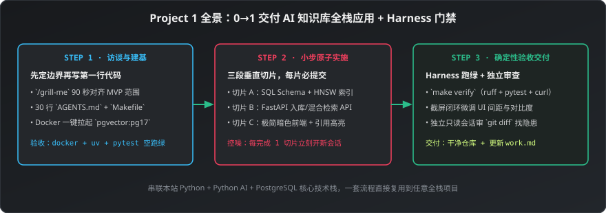


本篇是 **⚡ 有经验速通版**（直接给蓝图、脚本与验收门禁）。如果你想一步步跟着敲、看清每一步背后原理，请切换到 **🧱 基础分步版**：
[Step 1 访谈建基](/agent-projects/p1-step1-plan-and-harness/) → [Step 2 垂直切片实施](/agent-projects/p1-step2-backend-frontend/) → [Step 3 确定性验证交付](/agent-projects/p1-step3-verify-and-ship/)




## 1. 架构目标与极简目录树 / Target Scope & Directory Blueprint


用 2026 前沿 **Harness Engineering** 流程从零交付一个可上线的私有 AI 知识库：支持上传 Markdown 切片入库、PostgreSQL `pgvector` + 全文检索 RRF 混合召回、带来源编号问答，以及单文件暗色前端。



Deliver an end-to-end private AI Knowledge Base (Markdown ingestion, PostgreSQL `pgvector` + full-text RRF hybrid search, cited answers, and a dark UI) using 2026 Harness Engineering discipline:


```text
ai-kb-fullstack/
├── AGENTS.md              # 30 行项目铁律与必跑验证命令
├── work.md                # 3 个切片进度看板（跨会话交接）
├── Makefile               # `make up` / `make verify` 一键门禁
├── docker-compose.yml     # pgvector/pgvector:pg17
├── sql/001_init.sql       # kb_chunks 表 + HNSW + GIN 索引
├── app/
│   ├── main.py            # FastAPI: /health, /ingest, /query
│   ├── rag.py             # 切分 + Embedding + SQL RRF 混合检索
│   └── static/index.html  # 零构建极简暗色搜索与引用高亮 UI
└── tests/
    └── test_api.py        # pytest 集成冒烟测试（mock embedding 保速）
```

## 2. 三大 Agent CLI 核心操作对照表 / `agy` · `claude` · `codex` Command Map

| 阶段 Stage | Google Antigravity (`agy`) | Claude Code (`claude`) | OpenAI Codex (`codex`) |
| :--- | :--- | :--- | :--- |
| **需求访谈对齐** | 启动后直接敲 `/grill-me` | 要求：“先问我 4 个澄清问题再出 Plan” | 同左，或开启 Plan 规划输出 |
| **切规划模式** | `Shift+Tab` 切 `plan` 或 `/plan` | `Shift+Tab` 切 Plan Mode | 提示先输出 `PLAN.md` 确认后再改 |
| **每切片完清噪** | `/compact` 或 `Ctrl+D` 重开 `agy` | `/clear` 开干净会话 | 新开会话读 `AGENTS.md` + `work.md` |
| **审 Diff / 门禁** | `/diff` + `Ctrl+R` 审 Artifact | `!git diff --stat` + 跑 `make verify` | 独立终端跑 `make verify` + 审 Diff |

## 3. 核心 Harness 资产（直接复制用） / Copy-Paste Harness Files

```makefile
# Makefile — 把验收标准变成机器 Exit Code 0
.PHONY: up migrate test verify

up:
	docker compose up -d

migrate:
	psql "$$DATABASE_URL" -f sql/001_init.sql

verify:
	uv run ruff check app tests
	uv run pytest -q
	@echo "ALL HARNESS GATES PASSED"
```

```markdown
# AGENTS.md
## Commands
- Start DB: `make up && make migrate`
- Verify (MUST pass before done): `make verify`

## Rules
1. Work in vertical slices (SQL -> API -> UI); commit after each green slice.
2. All RAG queries MUST enforce `tenant_id` filter + return citation IDs.
3. Keep frontend single-file in `app/static/index.html` (#1d1f21 bg, #2bbc8a accent).
4. Update `work.md` at the end of every slice.
```

## 4. 三段垂直切片极速派活指令 / 3 Vertical Slice Prompts


按顺序分 **3 个干净短会话**派活，每个切片跑通 `make verify` 并 `git commit` 后立刻清上下文进入下一片：
1. **切片 1（底座）**：*“读 `AGENTS.md`，生成 `docker-compose.yml`、`sql/001_init.sql`（含 `halfvec(1536)` HNSW 与 `tsvector` GIN 索引）及 `Makefile`，跑通建表与空测试并更新 `work.md`。”*
2. **切片 2（API）**：*“读 `AGENTS.md` 和 `work.md`，在 `app/rag.py` 与 `app/main.py` 实现 `/ingest`、`/query`（单 SQL RRF 混合检索 + 租户隔离），补齐 `tests/test_api.py`，跑通 `make verify`。”*
3. **切片 3（UI + 独立审查）**：*“实现 `app/static/index.html` 暗色知识库界面并启动服务用 `curl` 与截图验证；最后新开一个只读会话审查 `git diff` 检查 SQL 注入与边界条件。”*



Execute in **3 fresh, focused sessions** (commit + reset context after each green `make verify`):
1. **Slice 1 (Foundation)**: Docker PG17 + `001_init.sql` (`halfvec` HNSW + GIN) + `Makefile`.
2. **Slice 2 (API & Tests)**: `/ingest` & `/query` single-SQL RRF retrieval with `tenant_id` ACL + `pytest` suite.
3. **Slice 3 (UI & Independent Review)**: Single-file dark UI + live `curl`/screenshot check + separate read-only session auditing `git diff`.

