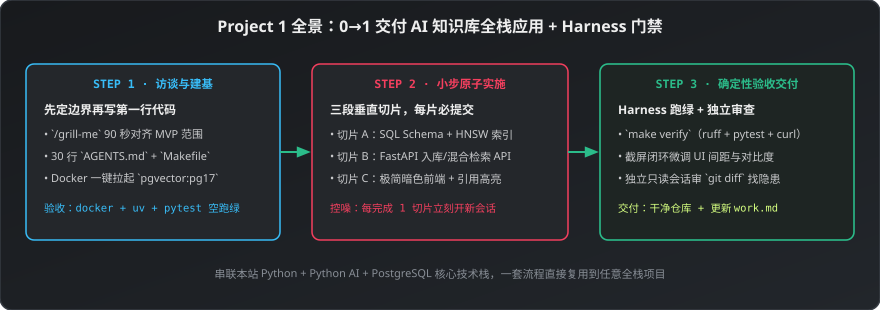


当前为 **🧱 基础分步版（Project 1 · 第 1/3 步）**。如果你已经有全栈经验、想 5 分钟直接拿完整蓝图，点这里跳 **[⚡ Project 1 速通版](/agent-projects/p1-express-fullstack-ai-kb/)**。




## 1. 第 1 步：别急着写代码，先让 Agent “反向访谈”你 90 秒 / Step 1: Interview Before Code


新手和老手最大的差别就在开工前 2 分钟：新手直接甩一句 *“帮我做一个 AI 知识库网站”*，结果 Agent 自己发挥出一堆你根本不需要的用户登录、Redis、消息队列，越写越复杂直接崩盘。

**正确起手式**：新建空文件夹 `ai-kb-fullstack`，打开终端启动你的 Agent（`agy`、`claude` 或 `codex`），发第一条消息先对齐 MVP 边界：



Never open a blank folder and say *"Build me an AI knowledge base."* Force a 90-second requirements interview first to lock MVP scope and eliminate over-engineering:


```text
# Antigravity CLI (agy) 直接加 /grill-me；Claude Code / Codex 用同段文字即可：
我想从 0 到 1 做一个最小可用的私有 AI 知识库（支持上传 Markdown、混合检索问答、暗色网页界面）。
先不要写任何代码，请每次问我 1 个最关键的澄清问题并给出推荐选项，帮我把技术栈、数据隔离和 MVP 边界定死。 /grill-me
```


经过 3~4 轮一问一答，你会自然收敛出清晰的 MVP 边界：**FastAPI + PostgreSQL (`pgvector`) + 单文件暗色 HTML + 无复杂登录（先用 `tenant_id` 请求头隔离）**。



Within 3–4 quick Q&A turns, you lock down a crisp MVP: FastAPI + PostgreSQL (`pgvector`) + single-file dark HTML + `tenant_id` isolation without premature auth bloat.


## 2. 第 2 步：种下项目的“定海神针”——`AGENTS.md` + `work.md` + `Makefile` / Step 2: Plant Harness Files


在写第一行业务代码之前，先把**规矩**和**自动化检查门禁**建好。这样后面不管开几个新会话，Agent 都不会跑偏：



Establish rules (`AGENTS.md`), state (`work.md`), and a one-command verification gate (`Makefile`) *before* generating application code:


```bash
mkdir ai-kb-fullstack && cd ai-kb-fullstack
git init
uv init --python 3.12
uv add fastapi uvicorn psycopg[binary] pgvector openai pydantic
uv add --dev pytest httpx ruff
```

```yaml
# docker-compose.yml — 一行起带 pgvector 的 PostgreSQL 17
services:
  db:
    image: pgvector/pgvector:pg17
    environment:
      POSTGRES_USER: kb
      POSTGRES_PASSWORD: kb
      POSTGRES_DB: kb
    ports:
      - "5432:5432"
```

```sql
-- sql/001_init.sql — 租户权限 + 原生全文检索 + halfvec 向量一次到位
CREATE EXTENSION IF NOT EXISTS vector;

CREATE TABLE IF NOT EXISTS kb_chunks (
    id         BIGINT GENERATED ALWAYS AS IDENTITY PRIMARY KEY,
    tenant_id  TEXT NOT NULL,
    doc_source TEXT NOT NULL,
    content    TEXT NOT NULL,
    fts        TSVECTOR GENERATED ALWAYS AS (to_tsvector('simple', content)) STORED,
    embedding  HALFVEC(1536) NOT NULL,
    created_at TIMESTAMPTZ NOT NULL DEFAULT NOW()
);

CREATE INDEX IF NOT EXISTS idx_kb_hnsw ON kb_chunks USING hnsw (embedding halfvec_cosine_ops);
CREATE INDEX IF NOT EXISTS idx_kb_fts  ON kb_chunks USING gin (fts);
CREATE INDEX IF NOT EXISTS idx_kb_ten  ON kb_chunks (tenant_id);
```

## 3. 本步验收标准（全部打钩再进 Step 2） / Step 1 Exit Criteria


- [ ] `docker compose up -d` 启动数据库，成功执行 `sql/001_init.sql` 无报错。
- [ ] 根目录已存在极简 `AGENTS.md`（≤ 30 行）、`work.md` 与 `Makefile`。
- [ ] 执行 `git add . && git commit -m "chore: init harness, pgvector schema & uv env"` 留好第一个干净存档点！

**下一节预告**：[Project 1 · Step 2：垂直切片实施后端 API 与暗色前端 →](/agent-projects/p1-step2-backend-frontend/)



- [ ] `docker compose up -d` starts PG17 cleanly and `001_init.sql` succeeds.
- [ ] `AGENTS.md`, `work.md`, and `Makefile` are in place.
- [ ] Initial clean commit created. Next up: [Step 2 — Vertical Slices →](/agent-projects/p1-step2-backend-frontend/)

