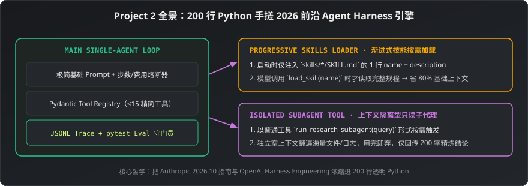


本篇是 **⚡ 有经验速通版**（直接给完整核心骨架与架构设计）。想逐行拆解每个模块，请走 **🧱 基础分步版**：
[Step 1 单循环与工具注册](/agent-projects/p2-step1-single-loop-core/) → [Step 2 渐进式 Skills 加载](/agent-projects/p2-step2-progressive-skills/) → [Step 3 子代理隔离与 Eval](/agent-projects/p2-step3-subagent-and-eval/)




## 1. 为什么值得亲手写这 200 行？ / Why Build This Yourself?


2026 年最核心的 Agent 共识（见 [AP-05 前沿风向](/agent-playbook/05-frontier-2026-harness-and-subagents/)）只有三个零件：**单主循环（Single Loop）+ 渐进式技能（Progressive Skills）+ 上下文隔离型只读子代理（Isolated Subagent）**。亲手写完这 4 个小文件，你就彻底看透 Claude Code / Codex / Antigravity 底层在干什么！



Modern frontier harnesses boil down to three clean building blocks: a bounded **Single Loop**, on-demand **Progressive Skills**, and a **Context-Isolating Read-Only Subagent** exposed as an ordinary tool.


```text
mini-harness/
├── skills/
│   ├── code-review/SKILL.md     # 仅按需加载的评审规程
│   └── sql-audit/SKILL.md       # 仅按需加载的 SQL 安全规程
├── harness/
│   ├── core.py                  # 单循环 + 步数熔断 + JSONL Trace
│   ├── skills.py                # 扫描摘要 + load_skill 按需加载
│   └── subagent.py              # 独立空上下文只读调研子代理工具
└── tests/test_evals.py          # pytest 回归门禁（验证技能触发与拒答）
```

## 2. 浓缩核心代码：渐进式 Skills + 隔离 Subagent / Core Mechanics in 55 Lines

```python
from pathlib import Path
import yaml

def index_skills(skills_dir: Path) -> dict[str, tuple[str, Path]]:
    """启动时只解析 frontmatter 摘要（~15 tokens/条），不塞入正文！"""
    catalog: dict[str, tuple[str, Path]] = {}
    for md in sorted(skills_dir.glob("*/SKILL.md")):
        raw = md.read_text(encoding="utf-8")
        _, fm, _ = raw.split("---", 2)
        meta = yaml.safe_load(fm)
        catalog[meta["name"]] = (meta["description"], md)
    return catalog

def make_load_skill_tool(catalog: dict[str, tuple[str, Path]]):
    def load_skill(name: str) -> dict:
        if name not in catalog:
            return {"error": f"Unknown skill. Available: {list(catalog)}"}
        return {"skill": name, "instructions": catalog[name][1].read_text(encoding="utf-8")}
    return load_skill

def run_isolated_research_subagent(client, model: str, question: str, readonly_tools: dict) -> dict:
    """独立空上下文翻遍海量文件，用完即弃，只把精炼结论回传主循环！"""
    sub_messages = [
        {"role": "system", "content": "你是只读调研子代理。充分检索后仅返回 <=250 字精炼事实与文件路径。"},
        {"role": "user", "content": question},
    ]
    # 复用同一份受限 run_loop，仅传入只读工具（list/grep/read），max_steps=6
    res = run_loop(client, model, sub_messages, readonly_tools, max_steps=6)
    return {"summary": res["answer"], "sub_steps": res["steps"]}
```

## 3. 用三大 CLI 辅助你快速落地本项目 / Tri-Tool Acceleration Commands

| 任务 Task | Antigravity (`agy`) | Claude Code (`claude`) | OpenAI Codex (`codex`) |
| :--- | :--- | :--- | :--- |
| **生成并自测 `skills.py`** | `agy -i "按 AGENTS.md 实现 harness/skills.py 并跑 pytest"` | `claude "实现 harness/skills.py 并确保 pytest 全绿"` | `codex "implement harness/skills.py and run pytest"` |
| **无头批量跑 Eval** | `agy -p "分析 tests/trace.jsonl 里的失败用例"` | `claude -p "总结最近 Eval 失败原因"` | `codex exec "summarize eval failures"` |
| **验收红线** | `uv run pytest -q`（测技能按需加载、子代理零写权限、越权拒答） | 同左 | 同左 |
