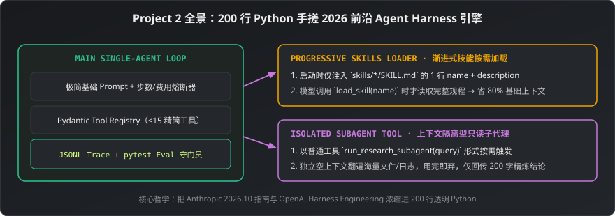


当前为 **🧱 基础分步版（Project 2 · 第 1/3 步）** · 想 5 分钟直接拿完整骨架，点这里跳 **[⚡ Project 2 速通版](/agent-projects/p2-express-mini-agent-harness/)**。




## 1. 为什么先搭极简“单循环”，而不是一上来画 5 个 Agent？ / Why Start with One Clean Loop


按 2026 前沿共识（[AP-05](/agent-playbook/05-frontier-2026-harness-and-subagents/)），**一切可靠 Agent 的心脏都是一条克制、可观测的 Single Loop**。我们先初始化极简工程并用 Pydantic 锁死工具边界：



Every production harness begins with a transparent, bounded single loop. Initialize the repo and define type-safe tools with Pydantic:


```bash
mkdir mini-harness && cd mini-harness
uv init --python 3.12 && uv add openai pydantic pyyaml && uv add --dev pytest ruff
```

## 2. 写出可追踪、带熔断的 `harness/core.py` / Bounded Loop with JSONL Trace


注意这段 45 行底座里的三个工业级细节：① `max_steps` 防止模型死循环烧账单；② 工具报错不崩进程，而是作为可读提示退回给模型自纠；③ 每步写入 `trace` 列表，方便 Step 3 跑自动化 Eval！



Three production details baked in from line one: hard `max_steps` caps, recoverable tool error feedback so the model self-corrects, and structured step traces for Step 3 evals:


```python
import json, time
from dataclasses import dataclass
from pathlib import Path
from typing import Callable, Type
from pydantic import BaseModel, ValidationError

@dataclass(slots=True)
class Tool:
    name: str
    description: str
    args_model: Type[BaseModel]
    fn: Callable[[BaseModel], dict]

    def schema(self) -> dict:
        return {
            "type": "function",
            "function": {
                "name": self.name,
                "description": self.description,
                "parameters": self.args_model.model_json_schema(),
            },
        }

    def call(self, raw_args: str) -> str:
        try:
            parsed = self.args_model.model_validate_json(raw_args)
            return json.dumps(self.fn(parsed), ensure_ascii=False)
        except ValidationError as err:
            return json.dumps({"error": "invalid_args", "hint": str(err)}, ensure_ascii=False)
        except Exception as err:
            return json.dumps({"error": str(err)}, ensure_ascii=False)

def run_loop(client, model: str, messages: list[dict], tools: dict[str, Tool], max_steps: int = 8, trace_path: Path | None = None) -> dict:
    schemas = [t.schema() for t in tools.values()]
    trace: list[dict] = []

    for step in range(1, max_steps + 1):
        t0 = time.perf_counter()
        resp = client.chat.completions.create(model=model, messages=messages, tools=schemas, temperature=0.0)
        msg = resp.choices[0].message
        messages.append(msg.model_dump(exclude_none=True))

        if not msg.tool_calls:
            return {"answer": msg.content or "", "steps": step, "trace": trace}

        for tc in msg.tool_calls:
            tool = tools.get(tc.function.name)
            out = tool.call(tc.function.arguments) if tool else '{"error": "tool_not_found"}'
            rec = {"step": step, "tool": tc.function.name, "args": tc.function.arguments, "ms": round((time.perf_counter() - t0) * 1000, 1)}
            trace.append(rec)
            if trace_path:
                with trace_path.open("a", encoding="utf-8") as f:
                    f.write(json.dumps(rec, ensure_ascii=False) + "\n")
            messages.append({"role": "tool", "tool_call_id": tc.id, "content": out})

    return {"answer": "Max steps reached.", "steps": max_steps, "trace": trace}
```

## 3. 本步验收标准 / Step 1 Exit Criteria


- [ ] 用 `pytest` 写一条单元测试：传错 JSON 参数给 `Tool.call(...)` 时返回 `invalid_args` 而不抛未捕获异常。
- [ ] 用 Mock Client 验证达到 `max_steps` 时能优雅终止并写出 `trace.jsonl`。

**下一节预告**：[Project 2 · Step 2：实现渐进式 Skills 加载器，砍掉 80% 基础提示词 →](/agent-projects/p2-step2-progressive-skills/)



- [ ] Unit test confirms invalid tool JSON returns a clean `invalid_args` error instead of crashing.
- [ ] Mock loop test confirms `max_steps` terminates cleanly and logs `trace.jsonl`. Next: [Step 2 — Progressive Skills →](/agent-projects/p2-step2-progressive-skills/)

