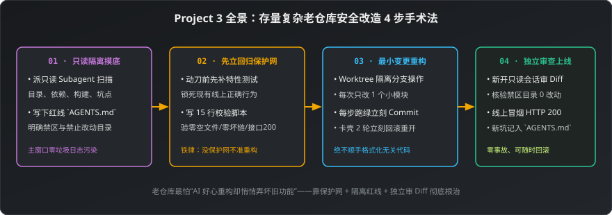


本篇是 **⚡ 有经验速通版**（直接给老仓库改造 4 步 SOP 与核心校验脚本）。想手把手跟练每一步细节，请走 **🧱 基础分步版**：
[Step 1 只读隔离摸底](/agent-projects/p3-step1-audit-and-boundaries/) → [Step 2 保护网与小步重构](/agent-projects/p3-step2-characterization-refactor/) → [Step 3 独立审 Diff 发布](/agent-projects/p3-step3-diff-review-release/)




## 1. 老仓库改造 4 条生死红线 / 4 Non-Negotiable Legacy Rules


接手多年积累的历史仓库（无文档、旧版本依赖、线上有真实用户），用 Agent 改造绝不能上来就喊“帮我重构一下”，必须严格按 4 步手术 SOP 执行：
1. **只读隔离摸底**：先派只读子代理/独立只读会话把目录、构建命令、隐藏环境坑（如 Node 版本兼容、旧插件依赖）摸清，浓缩成 30 行 `AGENTS.md`（写死禁区目录！）。
2. **先立保护网再动刀**：在改第一行业务代码前，先写**特性测试（Characterization Tests）+ 产物校验脚本**，锁死老功能不能坏。
3. **Worktree + 单模块小步**：开独立分支，一次只动一个模块；一旦 Agent 连续两轮越改越乱，立刻 `git checkout -- .` 重开干净会话。
4. **独立只读会话对抗审 Diff**：改完后另开**全新无偏见会话**专门审查 `git diff`，核验禁区目录 0 变更、无静默破坏、线上冒烟 HTTP 200。



Never tell an agent "refactor this legacy repo." Follow the 4-step surgical protocol: (1) read-only isolated audit into `AGENTS.md` with hard off-limits paths, (2) lock current behavior with characterization tests + build validators *before* editing, (3) small single-module commits inside a `git worktree`, and (4) a fresh read-only review session auditing `git diff`.


## 2. 一键验收守护脚本模板（可直接放进老仓库） / Copy-Paste Release Guard Script

```bash
#!/usr/bin/env bash
# scripts/verify-release.sh — 老仓库发布前必过三道闸门
set -euo pipefail

echo "1/3 Checking off-limits legacy paths are untouched..."
if [ -n "$(git status --short source/_posts/ legacy_migrations/ 2>/dev/null || true)" ]; then
  echo "ERROR: Off-limits legacy files were modified!" >&2
  exit 1
fi

echo "2/3 Running build & test suite..."
npm run build && pytest -q

echo "3/3 Checking zero empty build artifacts..."
EMPTY_COUNT=$(find public dist -type f -empty 2>/dev/null | wc -l)
if [ "$EMPTY_COUNT" -gt 0 ]; then
  echo "ERROR: Found $EMPTY_COUNT zero-byte build artifacts!" >&2
  exit 1
fi
echo "ALL LEGACY GUARD GATES PASSED!"
```

## 3. 三大 CLI 工具老仓库实操对照 / `agy` · `claude` · `codex` Legacy SOP

| 手术阶段 Stage | Antigravity (`agy`) | Claude Code (`claude`) | OpenAI Codex (`codex`) |
| :--- | :--- | :--- | :--- |
| **只读摸底写规则** | `agy -p "只读分析仓库结构与构建命令，输出极简 AGENTS.md 草案"` | `claude -p "只读扫描仓库，列出构建命令与风险点"` | `codex exec "read-only audit repo and draft AGENTS.md"` |
| **隔离分支重构** | `git worktree add ../refactor refactor/v2` 后在该目录启动 `agy` | 同左，在 worktree 内跑 `claude` | Codex App/CLI 原生新建 Worktree 分支任务 |
| **独立对抗审 Diff** | 新开终端：`git diff main \| agy -p "以严苛审稿人视角找退化风险"` | `git diff main \| claude -p "审查边界漏洞与越权改动"` | `codex review` 独立审查当前分支 Diff |
