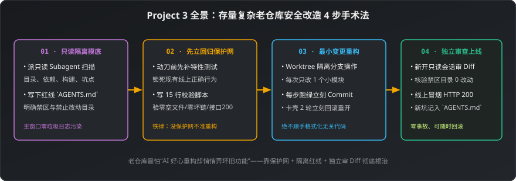


当前为 **🧱 基础分步版（Project 3 · 第 1/3 步）** · 想直接拿完整 4 步 SOP 与守护脚本，请跳 **[⚡ Project 3 速通版](/agent-projects/p3-express-legacy-repo-refactor/)**。




## 1. 为什么老仓库第一轮必须“只读隔离”？ / Why Audit Read-Only First


老仓库里到处是“暗雷”：几年前锁死的旧依赖（比如 Node 22 跑老 Hexo 3.7.1 静默生成 0 字节文件）、奇怪的线上发布分支、绝对不能动的历史迁移脚本或老文章目录。如果让主力编码会话亲自翻 200 个文件，上下文瞬间被无关老代码塞爆。

**标准动作**：用独立只读会话（或子代理）先把仓库扒一遍，只输出一份不超过 1 页纸的**体检报告**：



Legacy repos hide landmines: ancient lockfiles, quirky deploy branches, and untouchable historical folders. Run a strictly read-only audit first so exploration noise never pollutes your main implementation session:


```bash
# Antigravity CLI (agy) / Claude Code / Codex 无头只读摸底通用命令
agy -p "严格只读（禁止修改任何文件）：检查目录结构、package.json/pyproject.toml、git 分支与远程发布方式，列出 1) 构建/测试命令 2) 潜在兼容性风险 3) 绝对不该改的历史目录，输出一份 25 行极简 AGENTS.md 草案。"
```

## 2. 把体检结果固化成两张“护身符” / Freeze Boundaries into `AGENTS.md` & `work.md`


人工确认这份体检报告后，把**不可妥协的红线**写进根目录 `AGENTS.md`（例：*“严禁改动 `legacy_posts/` 与旧版 API v1 路径”*、*“线上部署分支为 `master`，严禁错配到源码分支”*），并把本次改造拆解成 3 个小里程碑写进 `work.md`。



Review the audit, lock non-negotiable off-limits directories and deploy branch rules into `AGENTS.md`, and write your 3-step refactoring checklist into `work.md`.


## 3. 本步验收标准 / Step 1 Exit Criteria


- [ ] 已在本地真实跑通一次老仓库的原始构建/启动命令，确认基线现状（并把踩到的环境安装参数记入 `AGENTS.md`）。
- [ ] `AGENTS.md` 明确列出「禁区文件/目录」与「必跑验收命令」。
- [ ] 提交 `docs: add AGENTS.md and work.md audit baseline`。

**下一节预告**：[Project 3 · Step 2：先立特性回归保护网，再 Worktree 最小变更重构 →](/agent-projects/p3-step2-characterization-refactor/)



- [ ] Baseline build/run verified locally; any special install flags recorded in `AGENTS.md`.
- [ ] Hard off-limits paths clearly documented. Next: [Step 2 — Safety Net & Surgical Refactor →](/agent-projects/p3-step2-characterization-refactor/)

