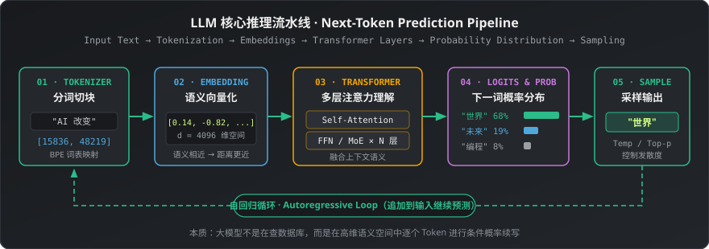


1. **为什么大模型不认识“汉字”和“单词”**，只认识 Token ID 整数序列。
2. **Embedding（词向量）**如何把文字映射到几千维的“语义地图”。
3. **Next-Token Prediction（下一个词预测）**为何既能诞生惊人推理能力，又必然伴随**幻觉（Hallucination）**。
4. **Temperature / Top-p** 两个核心参数在实际工程中的黄金调节法则。




## 1. 先破除一个误区：大模型不是“搜索引擎” / First Myth-Bust: LLMs Are Not Search Engines


很多人第一次用 ChatGPT、Claude 或 Gemini 时，会下意识以为它背后连着一个巨大的“百度百科 + 数据库”，你问一个问题，它就去数据库里把标准答案查出来念给你听。

**事实完全相反。**大语言模型（Large Language Model, LLM）在没有任何外部工具时，本质上是一个**在海量人类文本上训练出来的“超级文字接龙引擎”**。它内部没有存着一篇篇完整的网页原文，而是把几万亿字的语言规律、逻辑关系与世界知识，压缩成了几百亿甚至上万亿个浮点数权重（Weights）。

当你输入一句提示词时，它做的唯一一件事就是反复回答这个问题：
> **“根据前面已经出现的所有文字，下一个最合理的片段（Token）应该是什么？”**



When most people try ChatGPT, Claude, or Gemini for the first time, they instinctively imagine a giant encyclopedia database sitting behind the scenes that looks up the right answer and reads it back.

**The reality is fundamentally different.** Without external tools, a Large Language Model (LLM) is essentially a **supercharged text-completion engine** trained on trillions of words of human writing. It does not store verbatim copies of web pages; instead, it compresses linguistic patterns, reasoning structures, and world knowledge into billions (or trillions) of floating-point weights.

Every time you send a prompt, the model repeatedly solves one single mathematical problem:
> **"Given all the text that has appeared so far, what is the most probable next piece of text (Token)?"**


## 2. 第一关：分词器（Tokenizer）——模型眼里的文字长什么样？ / Step 1: Tokenization


计算机无法直接做“文字乘法”，因此进入神经网络的第一步，是把文本切成最小积木块——**Token**，再把每个积木块查表变成整数 ID。

现代主流模型几乎都使用 **BPE（Byte Pair Encoding，字节对编码）** 及其变体。它的核心直觉非常简单：**高频出现的字词组合成一个完整 Token，生僻词则拆成更小的词根或字节**。

这直接解释了三个你在日常使用中一定会遇到的“神奇现象”：
- **中英文计费差异**：常见英文单词（如 `apple`、`hello`）通常是 **1 个 Token**；而常见中文字符往往占 **1 ~ 2 个 Token**（早期词表对中文不友好时甚至 1 个汉字占 2~3 个 Token）。
- **数不清单词里有几个字母**：比如经典考题 `strawberry` 里有几个 `r`？因为模型看到的往往不是 10 个独立字母，而是 `["str", "aw", "berry"]` 这几个整块 ID，就像让你不看拼写直接背诵偏旁笔画数一样容易出错。
- **算不好多位数乘法**：`1234567` 可能被切成 `["123", "456", "7"]`，破坏了十进制的对齐规律。



Neural networks operate on numbers, not raw characters. The very first stage splits your text into atomic chunks called **Tokens** and maps each token to an integer ID in a vocabulary table (typically 50k–200k entries).

Most frontier models use **BPE (Byte Pair Encoding)** or its variants. The intuition is simple: **frequent words stay intact as a single token, while rare words are broken down into subwords or raw bytes.**

This single design detail explains three famous LLM quirks:
- **Chinese vs. English cost**: Common English words (`apple`, `hello`) usually take **1 token**, whereas Chinese characters often take **1–2 tokens** depending on vocabulary coverage.
- **Struggling to count letters**: Asking *"How many r's are in strawberry?"* trips up base models because they see chunk IDs like `["str", "aw", "berry"]`, not individual characters.
- **Weak mental arithmetic on large numbers**: A number like `1234567` may be sliced arbitrarily into `["123", "456", "7"]`, breaking decimal place alignment.


### 动手试试：用 Python 查看真实 Token 切分 / Hands-On: Inspect Real Tokens in Python

```python
# pip install tiktoken
import tiktoken

enc = tiktoken.get_encoding("o200k_base")  # Modern OpenAI tokenizer

samples = [
    "Artificial Intelligence changes everything.",
    "人工智能正在重塑软件工程。",
    "strawberry"
]

for text in samples:
    ids = enc.encode(text)
    pieces = [enc.decode([i]) for i in ids]
    print(f"Text:   {text}")
    print(f"Count:  {len(ids)} tokens -> {pieces}\n")
```


强烈推荐访问 [Tiktokenizer](https://tiktokenizer.vercel.app/)，直接粘贴你的中英文 Prompt，用彩色高亮实时观察不同模型是如何切分 Token 并估算 API 费用的。


## 3. 第二关：Embedding 词向量——把“含义”变成坐标 / Step 2: Embeddings — Turning Meaning into Geometry


拿到整数 ID（比如 `猫 = 8421`、`狗 = 9102`、`微波炉 = 5301`）还不够——整数本身没有语义远近之分（8421 和 9102 在数轴上并不比 5301 更像宠物）。

于是模型通过一张巨大的查询表，把每个 Token ID 映射成一个几千维的向量（例如 4096 维浮点数数组），称为 **Embedding（嵌入向量）**。你可以把它想象成一座**高维语义图书馆**：
- 每一个维度都隐含某种抽象特征（是否有生命、是否属于科技、情绪是正面还是负面、语法词性等）。
- 语义越相近的词，在这座空间里的**夹角越小（余弦相似度越高）**。
- 最著名的几何奇迹是向量加减法：`Vector("国王") - Vector("男性") + Vector("女性") ≈ Vector("王后")`。

进入 **Transformer** 几十层网络后，原本静态的词向量还会根据上下文动态更新——比如“**苹果**真好吃”和“**苹果**发布了新芯片”里的两个“苹果”，经过自注意力层（Self-Attention）后会移动向完全不同的语义区域。



An integer ID alone carries no semantic relationship (`cat = 8421` is not mathematically "closer" to `dog = 9102` than to `microwave = 5301`).

To fix this, the model maps every token ID to a high-dimensional vector of thousands of numbers (e.g., 4,096 dimensions) called an **Embedding**. Imagine a **multi-dimensional semantic map**:
- Each axis captures latent semantic features (living vs. non-living, technical vs. casual, sentiment, syntax, etc.).
- Words with similar meanings point in similar directions (high **cosine similarity**).
- Famously, semantic relationships behave like geometry: `Vector("King") - Vector("Man") + Vector("Woman") ≈ Vector("Queen")`.

As these vectors pass through dozens of **Transformer** layers, they become **contextualized**: the word `"Apple"` in *"I ate an apple"* and *"Apple launched a new chip"* gets pulled toward completely different regions of meaning space.


## 4. 第三关：概率分布与采样——Temperature 到底在调什么？ / Step 3: Probabilities & Sampling


经过 Transformer 最后一层计算后，模型并不会“铁口直断”只输出一个词，而是给词表里的全部 10 万+ 个候选 Token 各自打分（Logits），再通过 **Softmax** 变成相加为 100% 的概率分布。例如输入“床前明月光，疑是地上”，模型可能算出：`霜 (96%)`、`雪 (2.5%)`、`水 (0.4%)`……

接下来怎么从这张概率表里挑出真正输出的那个词？这就是 **Sampling（采样策略）** 的舞台：



At the final layer, the model does not simply pick one word. It outputs a score (**logit**) for every token in its vocabulary, which **Softmax** turns into a probability distribution summing to 100%.

How the system picks the next token from this distribution is controlled by **sampling parameters**:


| 参数 Parameter | 作用原理 Mechanism | 推荐取值 Recommended Values | 适用场景 Best Use Cases |
| :--- | :--- | :--- | :--- |
| **`temperature`** | 缩放概率分布的“尖锐度”：`0` 几乎总是选最高概率词；越高则小概率词机会越大 | `0.0 ~ 0.2`（严谨）<br>`0.6 ~ 0.8`（均衡）<br>`1.0+`（发散） | 代码生成、JSON 提取、事实问答用低温；头脑风暴、小说创意用中高温 |
| **`top_p` (Nucleus)** | 只保留概率从高到低累计达到 `p` 的最小候选池，截断离谱长尾词 | `0.9 ~ 0.95`（通用） | 防止高温时抽中毫无逻辑的乱码词，通常与 `temperature` 二选一微调 |
| **`max_tokens`** | 限制单次回复生成的最大 Token 上限 | 按业务设定 | 防止模型啰嗦或死循环烧光账单 |

## 5. 两个核心局限：上下文窗口与幻觉 / Two Core Constraints: Context Window & Hallucination


理解了上面的机制，你就能一眼看透大模型的两大“天生基因”：

1. **上下文窗口（Context Window）= 模型的“短期工作记忆”**
   模型本身是**无状态（Stateless）**的！所谓“多轮对话”，其实是客户端每次都把**从第一句话到当前这句话的全部聊天记录**重新拼接发给模型。一旦总长度超过 Context Window（如 128K 或 1M Tokens），最早的信息就会被裁掉，模型就会“失忆”。而且信息塞得太满时，还会出现 **Lost in the Middle（中间遗忘效应）**——开头和结尾记得最牢，中间容易漏看。

2. **幻觉（Hallucination）= 概率续写的必然副作用**
   模型的训练目标是“生成看起来最连贯、最像人类专家口吻的下一个词”，而不是“逐条去事实数据库交叉核验”。当你问它一个它没见过、训练数据里很稀疏的问题（例如某冷门 API 的内部参数、或今天刚发生的新闻）时，它依然会顺滑地拼出一段**语法完美、语气笃定、但完全编造的答案**。

> **治本之道**：绝不要让纯 LLM 凭空背诵实时事实或精确数据——给它接上 **RAG 检索**（中级 L2-01）或 **实时搜索/工具调用**（中级 L2-02），让它“开卷考试”！



Once you understand next-token prediction, two fundamental properties of LLMs immediately make sense:

1. **Context Window = Working Memory**
   LLMs are **stateless**. A "multi-turn conversation" only works because the application resends the entire chat history on every turn. Once the history exceeds the Context Window (e.g., 128K or 1M tokens), older messages are truncated. Even within limits, models suffer from **Lost in the Middle**—paying strongest attention to the beginning and end of long inputs.

2. **Hallucination = A Natural Side Effect of Probabilistic Fluency**
   Because the model is optimized to produce fluent, plausible continuations rather than verify facts against a ground-truth database, asking it about obscure facts or today's breaking news causes it to smoothly fabricate confident-sounding falsehoods.

> **The real cure**: Never rely on an ungrounded LLM as a factual database. Connect it to **RAG** (L2-01) and **Tool Use / Search** (L2-02) so it takes an *open-book exam*.


## 6. 核心术语中英对照表 / Bilingual Glossary

| 英文术语 Term | 中文译名 | 一句话通俗解释 Plain-English / Chinese Meaning |
| :--- | :--- | :--- |
| **Token** | 词元 | 模型读写与计费的最小文本切块单位 |
| **Embedding** | 词向量 / 嵌入 | 将文本语义编码为高维浮点数坐标向量 |
| **Autoregressive** | 自回归 | 每次预测 1 个新 Token 并拼回输入，循环往复直到结束 |
| **Context Window** | 上下文窗口 | 模型单次前向推理最多能同时“看见”的总 Token 数 |
| **Hallucination** | 幻觉 | 模型编造看似合理却不符合客观事实的内容 |
| **Temperature** | 温度参数 | 控制采样随机性的旋钮，越低越确定、越高越发散 |

## 7. 权威延伸阅读 / Further Reading

- 🎬 **Andrej Karpathy**: [Intro to Large Language Models (1-hour masterpiece)](https://www.youtube.com/watch?v=zjkBMFhNj_g) — 全球公认最佳 LLM 入门公开课。
- 🎨 **Jay Alammar**: [The Illustrated GPT-2](https://jalammar.github.io/illustrated-gpt2/) — 视觉化拆解自回归生成的经典图解文章。
- 🧪 **OpenAI / Interactive**: [Tiktokenizer Online](https://tiktokenizer.vercel.app/) — 亲手实验不同语言与代码的 Token 切分效果。
- 📄 **Stanford Research**: [Lost in the Middle: How Language Models Use Long Contexts](https://arxiv.org/abs/2307.03172) — 揭示长上下文注意力衰减规律的必读论文。
