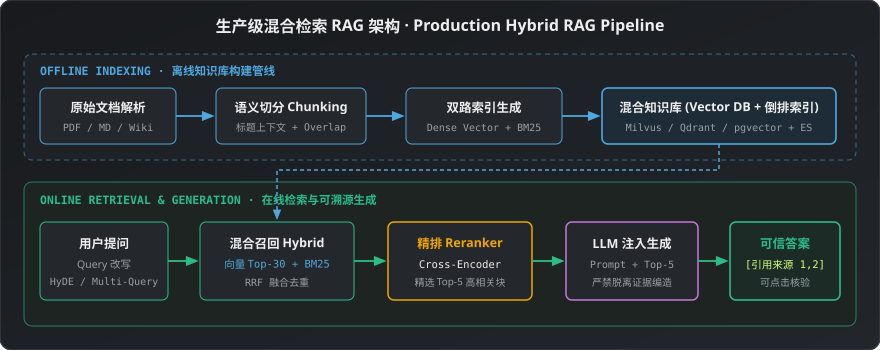


1. **RAG vs Fine-Tuning vs Long Context** 三者如何科学选型，不再盲目微调。
2. 生产级 RAG 的黄金三件套：**带上下文的 Chunking + Hybrid Search（向量+BM25）+ Cross-Encoder Rerank**。
3. 最小可运行的 Python Hybrid RAG 融合排序（RRF）核心代码与评估指标体系。




## 1. 为什么一定要用 RAG？ / Why RAG Instead of Fine-Tuning?


很多团队拿到一堆公司文档、产品手册或私有代码库后，第一反应是：“咱们微调（Fine-Tuning）一个专属模型吧！”——**这往往是投入产出比最低的坑**。

用考试来打比方：
- **微调（Fine-Tuning）** = 考前死记硬背。适合改变模型的**说话风格、输出格式、领域表达习惯**；但很难记住精确到数字的动态事实（今天改了报销政策，难道今晚重新训一遍模型？），而且无法告诉你答案出自哪一页。
- **RAG（Retrieval-Augmented Generation，检索增强生成）** = **带资料进考场开卷考试**。用户提问时，系统先从外部知识库精准翻出最相关的 3~5 段原文，贴进 Prompt 让大模型基于原文总结作答，并标出 `[来源 1]` 可点击核验！



When teams want an LLM to answer questions about private docs, SOPs, or internal wikis, their first instinct is often: *"Let's fine-tune our own model!"*—which is usually an expensive dead end.

Think of it as an exam:
- **Fine-Tuning** = Memorizing before the exam. Great for teaching **style, tone, domain conventions, or narrow structured skills**, terrible for rapidly changing facts and impossible to cite page-by-page.
- **RAG (Retrieval-Augmented Generation)** = **Taking an open-book exam**. At query time, your system retrieves the top 3–5 relevant passages from an external index, injects them into the prompt, and instructs the LLM to answer strictly with verifiable citations.


| 方案 Approach | 知识实时性 Freshness | 可溯源防幻觉 Grounding | 适合场景 Best For |
| :--- | :--- | :--- | :--- |
| **Long Context（直接塞全文）** | 实时 | 高 | 文档总量 < 50 页、低频单次深度分析（如审一份合同） |
| **RAG（检索增强）** | **秒级更新** | **极高（附原文引用）** | 企业知识库、客服问答、跨百万文档检索、权限隔离场景 |
| **Fine-Tuning（微调）** | 滞后（需重训） | 低（易编造） | 固定格式指令遵循、垂直语料风格、降低超长 Prompt 推理成本 |

## 2. 为什么“最简向量 RAG”在生产环境一定会翻车？ / Why Naive Vector RAG Fails in Production


教程里最常见的“10 行代码做 RAG”通常是：按每 500 字硬切文档 → 算 Embedding 存向量库 → 搜 Top-3 丢给 LLM。上线一周后，你立刻会遇到三大惨案：

1. **硬切撕裂语义**：表格的表头被切到了上一个 Chunk，数字落到了下一个 Chunk；或者段首写着“*该公司在 2026 年营收增长 40%*”，但“该公司”指代谁被切掉了！
2. **纯向量搜不准专有名词**：向量擅长理解语义（“笔记本电脑”≈“MacBook”），但对**精确错误码（如 `ERR_CONN_4092`）、人名、SKU 编号、缩写词**表现极差——它可能把 `ERR_4092` 召回成 `ERR_4091`。
3. **Top-K 噪声淹没重点**：召回 20 条里第 14 条才是真正答案，直接全塞给模型既烧钱又触发“中间遗忘”。



The classic "10-line tutorial RAG" (fixed 500-char chunks → single vector lookup → dump into prompt) almost always breaks in real production for three reasons:

1. **Context-destroying splits**: Fixed-length slicing tears table headers away from rows, or isolates pronouns (*"The company grew 40%"*) from the document title that named the company.
2. **Dense embeddings miss exact identifiers**: Vectors understand semantics (*"laptop"* ≈ *"MacBook"*), yet fail badly on exact error codes (`ERR_CONN_4092`), part numbers, API flags, and proper nouns.
3. **Noisy Top-K ranking**: A Bi-Encoder embedding compresses an entire paragraph into one vector, losing fine-grained token-to-token matching. The true answer often hides at rank #12 while distractors sit at #1–#3.


## 3. 生产级 RAG 的四大核心升级 / Four Production-Grade Upgrades

### 升级 1：结构感知切分 + Contextual Retrieval（上下文补全） / Upgrade 1: Structure-Aware & Contextual Chunking


- **按文档逻辑边界切分**：优先按 Markdown 标题层级（`# / ## / ###`）、段落、代码块、完整表格切分，保留 10%~15% 重叠窗口（Overlap）。
- **注入文档元信息（Contextual Header）**：在每个 Chunk 开头拼接 `[文档名 > 章节路径]`，甚至像 Anthropic 提出的 **Contextual Retrieval** 那样，在离线入库时用轻量小模型为每个片段补一句 30 字的上下文摘要（如“*本段节选自《2026 差旅报销规范》国际航班章节*”），检索失败率可直接下降 **35% ~ 49%**！



- **Respect document structure**: Split on headings, paragraphs, code blocks, and intact tables first, with 10%–15% overlap.
- **Prepend context (Contextual Retrieval)**: Prefix every chunk with `[Doc Title > Section Path]`—or generate a brief 1–2 sentence situating summary per chunk at index time (as popularized by Anthropic). This single change can cut retrieval failure rates by **35%–49%**.


### 升级 2：Hybrid Search（向量检索 + BM25 关键词检索 + RRF 融合） / Upgrade 2: Hybrid Search with Reciprocal Rank Fusion


把**语义向量（Dense Vector）**和**经典关键词倒排索引（BM25 / Sparse）**两条腿并排跑：向量负责抓同义改写，BM25 负责锁死精确型号、函数名和术语。

两者打分尺度不同（余弦相似度在 0~1，BM25 分数可能是 18.6），千万别硬加权！业界标准做法是用 **RRF（Reciprocal Rank Fusion，倒数排名融合）**，只看排名不看绝对分值：

> **RRF 核心公式**：`RRF(d) = Σ 1 / (k + rank_r(d))`，其中 `r ∈ {Dense, BM25}`，平滑常数通常取 `k = 60`。



Run **Dense Vector search** and **BM25 lexical search** in parallel: vectors capture paraphrases and intent, while BM25 nails exact identifiers, error codes, and technical terms.

Because cosine similarity (0–1) and BM25 scores (unbounded) live on incompatible scales, merge both ranked lists using **RRF (Reciprocal Rank Fusion)**—a parameter-free, battle-tested formula using only ranks (`k = 60`).


### 升级 3：Cross-Encoder Reranker（交叉编码器精排） / Upgrade 3: Cross-Encoder Reranking


**先粗排、后精排**是搜索推荐系统二十年沉淀下来的黄金架构：
1. **粗排（Hybrid Retrieval）**：毫秒级从百万文档里捞出 Top-30 ~ Top-50 候选块（追求高召回 Recall）。
2. **精排（Reranker，如 BGE-Reranker / Cohere Rerank）**：把 `(Query, Chunk)` 拼在一起送进 Cross-Encoder 做逐词深度交叉注意力打分，选出最精准的 **Top-5** 送给大模型（追求高精度 Precision）。



Use a two-stage **Retrieve → Rerank** funnel:
1. **Stage 1 (Hybrid Retrieval)**: Fast recall of the top 30–50 candidates across millions of chunks.
2. **Stage 2 (Cross-Encoder Reranker, e.g., BGE-Reranker / Cohere Rerank)**: Jointly encodes `(query, chunk)` with full cross-attention to surface the sharpest **Top-5** passages for the LLM.


### 最小可运行示例：Python RRF 混合融合 + 可溯源 Prompt / Minimal Python RRF Fusion Code

```python
from collections import defaultdict

def rrf_fuse(ranked_lists: list[list[str]], k: int = 60) -> list[tuple[str, float]]:
    """
    Fuse multiple ranked doc_id lists using Reciprocal Rank Fusion (RRF).
    ranked_lists: e.g. [dense_top_k_ids, bm25_top_k_ids]
    """
    scores = defaultdict(float)
    for results in ranked_lists:
        for rank, doc_id in enumerate(results, start=1):
            scores[doc_id] += 1.0 / (k + rank)
    return sorted(scores.items(), key=lambda x: x[1], reverse=True)

dense_hits = ["doc_A", "doc_C", "doc_B", "doc_E"]
bm25_hits  = ["doc_B", "doc_D", "doc_A", "doc_F"]

fused = rrf_fuse([dense_hits, bm25_hits])
print("Fused Top Candidates:", fused[:4])
# doc_A and doc_B rank highest because both semantic & lexical signals agree!
```

## 4. 升级 4：怎么衡量你的 RAG 好不好？ / Upgrade 4: Evaluating RAG Scientifically


千万不要凭“我随便问了两个问题感觉还行”就上线！把评测拆成**检索层**与**生成层**两个独立诊断维度（可借助开源框架 [RAGAS](https://docs.ragas.io/)）：



Never ship a RAG system on "vibes." Separate diagnostics into **Retrieval metrics** vs. **Generation metrics** (frameworks like [RAGAS](https://docs.ragas.io/) automate this):


| 层级 Layer | 指标 Metric | 含义与排障指引 Diagnostic Meaning |
| :--- | :--- | :--- |
| **检索层 Retrieval** | **Recall@K / Hit Rate** | 正确答案所在的 Chunk 有没有进入 Top-K？若低 → 改切分、加 Hybrid Search / Query 改写 |
| **检索层 Retrieval** | **MRR / NDCG** | 正确 Chunk 排得够不够靠前？若低 → 引入 Cross-Encoder Reranker |
| **生成层 Generation** | **Faithfulness（忠实度）** | 模型回答的每句话是否都能在检索到的原文里找到支撑？若低 → 调低温度、加严 Prompt 拒答约束 |
| **生成层 Generation** | **Answer Relevance** | 回答是否直击用户痛点而非答非所问？若低 → 优化 Prompt 结构与 Query 意图分解 |


企业内部知识库做 RAG 时，**绝对不能把所有人的文档建在同一个无权限池里**！必须在向量库/搜索引擎的 **Metadata Pre-Filtering** 阶段，按当前用户的角色/部门权限先过滤掉无权访问的文档，否则普通员工问一句就能把高管薪酬表给检索出来。


## 5. 权威延伸阅读 / Further Reading

- 📄 **Anthropic Engineering**: [Introducing Contextual Retrieval](https://www.anthropic.com/news/contextual-retrieval) — 实测展示 Contextual Embeddings + BM25 + Rerank 如何将检索失败率降低 67%。
- 📘 **Original RAG Paper**: [Retrieval-Augmented Generation for Knowledge-Intensive NLP Tasks (Lewis et al.)](https://arxiv.org/abs/2005.11401) — RAG 领域奠基论文。
- 🛠️ **RAGAS Framework**: [Automated Evaluation of RAG Pipelines](https://docs.ragas.io/) — 业界主流 RAG 自动化评测框架文档。
