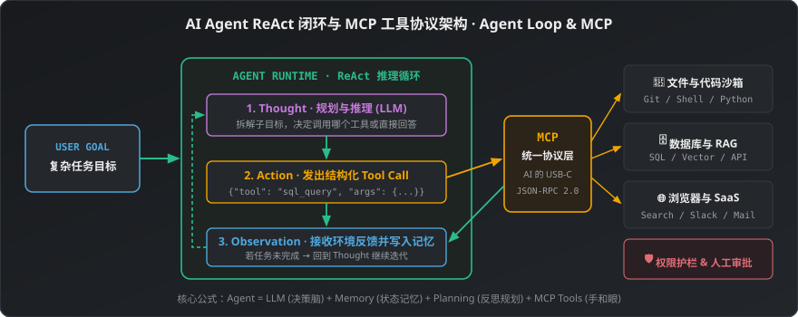


1. **Workflow（固定工作流）vs Agent（自主智能体）**的精准边界——什么时候该用 Agent，什么时候千万别用。
2. **Function Calling / Tool Use** 的底层交互真相（大模型其实**并不执行代码**，它只输出结构化调用意图）。
3. **MCP（Model Context Protocol）** 如何像 USB-C 一样终结 `M × N` 工具集成噩梦。
4. 生产级 Agent 必备的 **5 条工程护栏**（防死循环、防误删、防注入、上下文压缩、可观测追踪）。




## 1. 到底什么是 AI Agent？一个公式看懂 / What Actually Is an AI Agent?


市面上到处都在喊“Agent”，但把它扒开外壳，核心公式其实极其朴素：

> **核心公式**：`Agent = LLM（大脑） + Tools（手和眼） + Memory（状态记忆） + Loop（自主闭环）`

- **普通 Chatbot**：你说一句 → 它答一句 → 结束。它看不到实时报错，也不能自己去查数据库或改文件。
- **Workflow（确定性工作流）**：开发者把步骤写死（A → B → C），LLM 只负责其中一个节点的文本加工。特点是**成本可控、极其稳定**。
- **Agent（智能体）**：你只给一个**目标**（例如 *“帮我排查今天线上订单接口 500 报错的原因并提一个修复 PR”*），模型在循环中**自主决定**先查日志、再读代码、再跑单元测试，根据每一步的真实反馈（Observation）动态调整下一步行动，直到目标达成！



Strip away the hype, and every AI Agent reduces to one clean equation:

> **Core Formula**: `Agent = LLM (Brain) + Tools (Hands & Eyes) + Memory (State) + Loop (Autonomy)`

- **Chatbot**: Single turn in, single turn out. No interaction with the live world.
- **Deterministic Workflow**: The engineer hardcodes the control flow (`A → B → C`), invoking an LLM inside specific nodes. Predictable and cheap.
- **Agent**: You provide a **goal** (*"Diagnose today's 500 errors on `/checkout`, fix the bug, and verify tests pass"*), and the LLM dynamically chooses tools, reads real observations, adapts its plan, and loops until the task succeeds.


## 2. 拆解底层：Function Calling / Tool Use 究竟怎么工作？ / Under the Hood of Tool Use


新手常误以为大模型内部能直接“上网”或“连数据库”。**其实完全不是！**模型依然只能接收文本、输出文本。整个 Tool Use 是一场**模型与宿主程序（Runtime）之间的四步双簧**：

1. **声明工具清单**：宿主程序把可用工具的名称、自然语言描述、参数 JSON Schema 放进请求发给 LLM。
2. **模型输出调用请求**：模型分析用户意图后，**停止输出普通聊天文本**，而是返回一个结构化指令：`{"name": "query_order_status", "arguments": {"order_id": "ORD-9527"} }`。
3. **宿主程序真正执行**：你的后端代码收到这个指令后，在沙箱/服务端执行真正的 SQL 或 API 查询，拿到真实结果 `{"status": "shipped", "eta": "2026-11-28"}`。
4. **回传结果继续推理**：宿主程序把工具结果作为 `role: "tool"` 消息追加进上下文，再次发给 LLM，由模型决定是继续调下一个工具，还是整理自然语言回答用户。



LLMs never execute code or call APIs directly—they still only read and emit tokens. **Tool Use is a four-step handshake between the LLM and your Host Runtime:**

1. **Tool Declaration**: Your runtime sends tool names, descriptions, and JSON parameter schemas alongside the prompt.
2. **Structured Tool Call**: Instead of replying to the user, the LLM emits a structured request like `{"name": "query_order_status", "arguments": {"order_id": "ORD-9527"} }`.
3. **Local / Sandbox Execution**: Your host code validates arguments, executes the real function/API, and captures the return payload.
4. **Observation Feedback**: Your host appends the result as a `tool` message and invokes the LLM again to either call another tool or synthesize the final response.


### 35 行 Python 看透 ReAct Agent 核心循环 / Minimal 35-Line ReAct Loop

```python
import json

def run_agent(user_goal: str, tools: dict, max_steps: int = 8) -> str:
    messages = [{"role": "user", "content": user_goal}]

    for step in range(1, max_steps + 1):
        # 1. Ask LLM for next thought + either final text or tool_calls
        resp = call_llm(messages=messages, tool_schemas=get_schemas(tools))
        messages.append(resp.assistant_message)

        # 2. Exit condition: no tool requested -> task complete
        if not resp.tool_calls:
            return resp.text

        # 3. Execute requested tools safely & feed observations back
        for call in resp.tool_calls:
            fn = tools.get(call.name)
            try:
                result = fn(**call.arguments) if fn else f"Error: unknown tool {call.name}"
            except Exception as err:
                result = f"Tool execution error: {err}"

            messages.append({
                "role": "tool",
                "tool_call_id": call.id,
                "content": json.dumps(result, ensure_ascii=False)
            })

    return "Reached max_steps safety limit without final answer."
```

## 3. MCP（Model Context Protocol）：AI 世界的 USB-C 接口 / MCP: The USB-C Port for AI Tools


过去给 AI 接工具是一场 **`M × N` 集成灾难**：假设你有 `M` 个 AI 客户端（Claude Desktop、Cursor、自研 Web Agent）和 `N` 个外部系统（GitHub、Postgres、Slack、Notion），每对组合都要手写一遍专属胶水代码。

由 Anthropic 发起并迅速成为全行业事实标准的 **MCP（Model Context Protocol）**，用一套基于 **JSON-RPC 2.0** 的开放协议把它简化成了 **`M + N`**：
- **MCP Server（工具提供方）**：数据库、GitHub、文件系统只需按 MCP 标准暴露一次 `Tools`（可执行动作）、`Resources`（只读数据）和 `Prompts`（复用模板）。
- **MCP Client（AI 宿主应用）**：任何兼容 MCP 的 Agent 框架或 IDE，插上就能自动发现并调用所有工具，像 USB-C 插头即插即用！



Before MCP, connecting `M` AI apps (IDEs, chatbots, internal agents) to `N` data sources (GitHub, Postgres, Slack, Jira) meant writing `M × N` bespoke glue integrations.

**MCP (Model Context Protocol)**—an open standard built on JSON-RPC 2.0—collapses this into `M + N`:
- **MCP Servers** expose `Tools` (actions), `Resources` (readable context), and `Prompts` once through a uniform schema.
- **MCP Clients** (any compliant IDE, CLI, or custom Agent runtime) automatically discover and invoke any server plug-and-play—just like USB-C for hardware.


## 4. 生产级 Agent 五大保命护栏 / Five Production Guardrails You Must Build


Demo 里的 Agent 看起来酷炫，真放到生产环境若少了这五道护栏，轻则烧光 API 账单，重则删库跑路：



Agent demos look magical, but deploying one to production without these five guardrails risks runaway bills or destructive side effects:


| 护栏 Guardrail | 防什么风险 Prevents What? | 落地做法 Concrete Implementation |
| :--- | :--- | :--- |
| **1. 最大步数与预算熔断** | 工具报错导致模型无限重试死循环 | 硬编码 `max_steps`（如 10~20 步）与单次任务 Token/费用上限 |
| **2. 读写权限分级与人工审批 (HITL)** | 误删生产数据、误发群发邮件、误转账 | 只读工具自动放行；写操作/支付/删除必须弹窗暂停等待 Human-in-the-Loop 确认 |
| **3. 极简且清晰的工具文档** | 工具描述含糊导致模型频频传错参数 | 把工具描述当成写给初级工程师的 API 文档，给出明确参数例子与错误提示 |
| **4. 沙箱隔离执行** | Agent 生成的 Shell/Python 代码污染宿主机 | 代码执行一律放 Docker / MicroVM 隔离沙箱，严禁暴露生产私钥 |
| **5. 全链路 Trace 可观测** | 出错后完全不知道模型在哪一步想歪了 | 记录每一步的 Prompt、Tool Input/Output、耗时与 Token（如 Langfuse / OpenTelemetry） |


**永远从最简单的方案开始**：如果一条确定性的代码流水线（Workflow）就能稳定解决 95% 的需求，就不要硬上高自由度的自主 Agent。**把自主权留给真正需要动态探索、步骤不可预知的复杂任务**（如代码调试、跨源深度调研）。


## 5. 权威延伸阅读 / Further Reading

- 🏛️ **Anthropic Engineering**: [Building Effective Agents](https://www.anthropic.com/engineering/building-effective-agents) — 史上最接地气的 Agent 架构必读长文，清晰区分 Workflow 与 Agent 模式。
- 🔌 **Model Context Protocol**: [Official MCP Specification & Docs](https://modelcontextprotocol.io/) — 官方协议文档、SDK 与海量现成 MCP Server 清单。
- 📄 **ReAct Paper**: [ReAct: Synergizing Reasoning and Acting in Language Models (Yao et al.)](https://arxiv.org/abs/2210.03629) — ReAct 范式开山之作。
- 🧠 **Lilian Weng (OpenAI)**: [LLM Powered Autonomous Agents](https://lilianweng.github.io/posts/2023-06-23-agent/) — 系统梳理 Planning、Memory 与 Tool Use 的经典综述。
