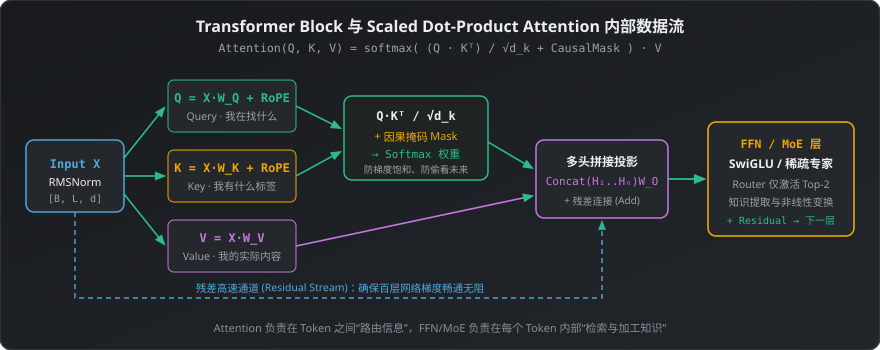


1. **为什么 RNN 被彻底淘汰？** 理解并行计算与长距离依赖的根本瓶颈。
2. **Q / K / V（Query, Key, Value）的直觉本质**，以及 `÷ √d_k` 与因果掩码（Causal Mask）的数学意义。
3. **现代 LLM 对 2017 原版 Transformer 的 4 大进化**：Pre-RMSNorm、RoPE 旋转位置编码、SwiGLU、以及 **MoE（混合专家）**。
4. 逐行读懂 45 行纯 PyTorch 实现的 **Multi-Head Causal Self-Attention**。




## 1. 为什么 Transformer 横扫了 RNN？ / Why Transformers Replaced RNNs


2017 年之前，处理序列文本的主流架构是 **RNN / LSTM**。它的工作方式像一条单行传送带：读完第 1 个词更新隐藏状态 `h₁`，再读第 2 个词更新 `h₂`……一直传到第 10,000 个词。

这带来两个致命硬伤：
1. **无法并行训练**：算 `h₁₀₀` 必须死等 `h₉₉` 算完，上万张 GPU 并行算力根本吃不满。
2. **信息压缩瓶颈**：前面几千字的历史全被塞进一个固定维度的向量里，越远的信息忘得越惨。

Google 2017 年的传奇论文 *《Attention Is All You Need》* 彻底抛弃了循环传递，提出 **Self-Attention（自注意力）**：让序列里的**任意两个 Token 直接握手通信（路径长度为 1）**，并且整句所有位置可以做成一次大矩阵乘法，把 GPU 算力瞬间拉满！



Before 2017, sequence modeling relied on **RNNs / LSTMs**, which processed tokens strictly one-by-one (`h₁ → h₂ → ... → h_T`). This caused two fatal bottlenecks:
1. **Sequential training bottleneck**: Computing step `t` had to wait for `t-1`, starving massively parallel GPUs.
2. **Information compression decay**: Thousands of prior tokens had to squeeze through a single fixed-size hidden state.

*Attention Is All You Need* (Vaswani et al., 2017) eliminated recurrence altogether. **Self-Attention** connects every pair of tokens directly in `O(1)` path length using dense matrix multiplications that saturate modern GPU Tensor Cores.


## 2. Q、K、V 到底是什么？用“图书馆检索”一秒讲透 / Intuition Behind Q, K, and V


看到公式 `Attention(Q, K, V) = softmax((Q · Kᵀ) / √d_k) · V` 时，初学者总被 `Q / K / V` 三个字母唬住。其实它就是一个**可微分的软哈希表（Soft Dictionary Lookup）**：

假设句子是：*“那只猫没有过马路，因为**它**太累了。”* 当模型处理到“**它**”这个词时：
- **Query (`Q`，查询向量)** = “**它**”发出的提问：*“我是一个代词，前面哪个名词是我的主语？”*
- **Key (`K`，索引标签)** = 句子里每个词亮出的名片：“猫”的名片写着 *“我是动物、主语、单数”*，“马路”的名片写着 *“我是地点名词”*。
- **点积匹配 (`Q · Kᵀ`)** = 计算“它”的提问和每个词名片的契合度——于是“它”和“猫”的点积得分飙升，和“马路”的得分很低。
- **缩放 (`÷ √d_k`)** = 如果向量维度 `d_k` 很大（如 128），点积方差会变大导致 Softmax 输出极端趋近 `0` 或 `1`，反向传播梯度消失；除以 `√d_k` 正好把方差拉回 `1`！
- **Value (`V`，实际内容)** = 每个词携带的真正语义载荷。最后按 Softmax 权重把各词的 `V` 加权求和，“**它**”的新向量就自然融合了“猫”的语义！

**什么是 Multi-Head（多头注意力）？**
就是同时开 32 个或 64 个独立的“注意力小分队”：1 号头专门追踪代词指代，2 号头专门匹配左右括号，3 号头专门关注主谓宾语法，最后把所有头的结果拼起来投影合并！



The formula `Attention(Q, K, V) = softmax((Q · Kᵀ) / √d_k) · V` looks intimidating, yet it is simply a **differentiable soft dictionary lookup**.

Consider: *"The cat didn't cross the street because **it** was too tired."* When processing **"it"**:
- **Query (`Q`)**: What **"it"** is looking for (*"Which prior noun am I referring to?"*).
- **Key (`K`)**: Each token's searchable label (*"cat" = animate noun/subject*; *"street" = location*).
- **Dot Product (`Q · Kᵀ`)**: Measures compatibility—**"it"** scores high with **"cat"** and low with **"street"**.
- **Scaling (`÷ √d_k`)**: Prevents large dot-product magnitudes from pushing `softmax` into flat, vanishing-gradient regions by normalizing variance back to `~1`.
- **Value (`V`)**: The actual semantic payload retrieved via weighted average, enriching **"it"** with **"cat"**'s meaning.

**Multi-Head Attention** runs `H` attention heads in parallel—one head tracks coreference, another matches code brackets, another tracks syntax—and concatenates their insights.


## 3. 45 行纯 PyTorch 手写 Multi-Head Causal Self-Attention / Minimal PyTorch Implementation

```python
import math
import torch
import torch.nn as nn
import torch.nn.functional as F

class CausalSelfAttention(nn.Module):
    def __init__(self, d_model: int = 512, n_heads: int = 8, max_len: int = 2048):
        super().__init__()
        assert d_model % n_heads == 0
        self.n_heads = n_heads
        self.d_head = d_model // n_heads
        # Project input x into Q, K, V in one fused linear layer
        self.qkv_proj = nn.Linear(d_model, 3 * d_model, bias=False)
        self.out_proj = nn.Linear(d_model, d_model, bias=False)
        # Lower-triangular causal mask prevents attending to future tokens
        mask = torch.tril(torch.ones(max_len, max_len)).view(1, 1, max_len, max_len)
        self.register_buffer("causal_mask", mask)

    def forward(self, x: torch.Tensor) -> torch.Tensor:
        B, T, C = x.shape  # Batch, SeqLen, d_model
        q, k, v = self.qkv_proj(x).chunk(3, dim=-1)

        # Reshape to [B, n_heads, T, d_head]
        q = q.view(B, T, self.n_heads, self.d_head).transpose(1, 2)
        k = k.view(B, T, self.n_heads, self.d_head).transpose(1, 2)
        v = v.view(B, T, self.n_heads, self.d_head).transpose(1, 2)

        # Scaled dot-product attention + causal masking
        scores = (q @ k.transpose(-2, -1)) / math.sqrt(self.d_head)
        scores = scores.masked_fill(self.causal_mask[:, :, :T, :T] == 0, float("-inf"))
        weights = F.softmax(scores, dim=-1)

        out = (weights @ v).transpose(1, 2).contiguous().view(B, T, C)
        return self.out_proj(out)

if __name__ == "__main__":
    attn = CausalSelfAttention(d_model=256, n_heads=8)
    dummy = torch.randn(2, 16, 256)
    print("Output shape:", attn(dummy).shape)  # torch.Size([2, 16, 256])
```


上面代码中显式构造 `[B, H, T, T]` 的 `scores` 矩阵会消耗 `O(T²)` 显存——当上下文拉到 128K 时直接 OOM。实际生产中调用 `F.scaled_dot_product_attention(..., is_causal=True)` 会自动触发 **FlashAttention**，利用 GPU 片上 SRAM 分块计算（Tiling），把显存从 `O(T²)` 降到 **`O(T)`** 且速度提升 2~4 倍！


## 4. 2017 原版 vs 2026 现代前沿 LLM 架构演进 / How Modern LLMs Evolved Beyond 2017


今天的 Llama / Qwen / DeepSeek / Claude / Gemini 等前沿大模型虽然仍流淌着 Transformer 血脉，但几乎都完成了四次关键“基因进化”：



Modern frontier LLMs still inherit the Transformer core, but four architectural upgrades have become universal defaults:


| 组件 Component | 2017 原版 Transformer | 现代前沿 LLM 标准 | 核心收益 Why It Matters |
| :--- | :--- | :--- | :--- |
| **归一化位置与方式** | Post-LayerNorm | **Pre-RMSNorm** | 省去均值计算更快，百层深网训练梯度极稳 |
| **位置编码 Position** | 绝对正弦波 (Sinusoidal) | **RoPE（旋转位置编码）** | 把相对距离编码成向量旋转角度，极易外推到超长上下文（128K~1M） |
| **前馈网络 FFN** | ReLU 两层全连接 | **SwiGLU + MoE（稀疏混合专家）** | MoE 拥有万亿总参数，但每个 Token 仅激活 Top-2 专家（如 30B），**大脑更大、推理更便宜** |
| **注意力头共享** | MHA（每个 Q 配独立 K/V） | **GQA / MLA（分组/潜在注意力）** | 大幅压缩推理期 KV Cache 显存（详见究极篇 L4-01） |

## 5. 权威延伸阅读 / Further Reading

- 📄 **Original Paper**: [Attention Is All You Need (Vaswani et al., 2017)](https://arxiv.org/abs/1706.03762)
- 🎥 **3Blue1Brown**: [Attention in Transformers, Visually Explained](https://www.youtube.com/watch?v=eMlx5fFNoYc) — 视觉直觉封神之作。
- 💻 **Andrej Karpathy**: [nanoGPT & Let's Build GPT from Scratch](https://github.com/karpathy/nanoGPT) — 仅 300 行代码的极简 GPT 实现。
- 📄 **RoPE Paper**: [RoFormer: Enhanced Transformer with Rotary Position Embedding (Su et al.)](https://arxiv.org/abs/2104.09864) — 苏剑林提出的旋转位置编码奠基论文。
