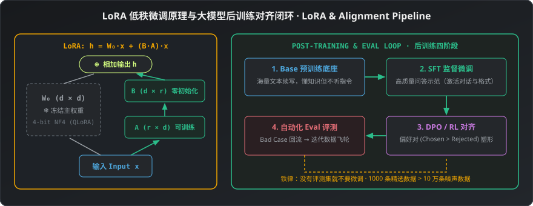


1. **微调决策树**：避开 80% 团队踩过的“盲目微调”深坑。
2. **LoRA / QLoRA 数学直觉与显存账本**：为什么一块 24GB 消费级显卡也能微调 14B~32B 模型？
3. **SFT → DPO 偏好对齐**：从“学会听话”到“学会审美品位与安全克制”。
4. **Eval-Driven Development（评测驱动开发）**：没有黄金评测集，微调就是盲人摸象。




## 1. 先踩刹车：什么时候才真的需要微调？ / Stop First: When Should You Actually Fine-Tune?


微调（Fine-Tuning）意味着你要承担**数据清洗、训练基础设施、版本回滚、底座模型升级后重训**的长期运维债。在启动训练之前，请严格按顺序过一遍这三道漏斗：

1. **Prompt + Few-Shot 试过没有？** 很多时候换一个更强的模型 + 写清 XML 规范 + 给 3 个例子，半小时就搞定了。
2. **如果是缺“业务事实知识”，上 RAG！**（见 [L2-01](/ai-tutorials/l2-01-rag-production-guide/)）微调记不住实时更新的数据。
3. **真正适合微调的 4 个黄金场景**：
   - **极致的延迟与成本压缩（蒸馏）**：用旗舰大模型生成 10,000 条高质量样本，微调一个 7B/8B 小模型，在特定垂直任务（如意图路由、SQL 生成、信息抽取）上达到旗舰 95% 效果，成本直降 **20 倍**、延迟降 **5 倍**。
   - **高度专有的输出格式或行业黑话**：如特定医疗编码规范、金融合规报文、小众领域 DSL 代码。
   - **严苛隐私 / 离线内网部署**：数据不可出网，必须在私有化开源小模型上压榨极致性能。
   - **定制人设与行为对齐**：改变拒答边界、对话语气或特定交互协议。



Fine-tuning creates ongoing engineering debt (data curation, GPU runs, regression testing, re-training whenever a better base model drops). Follow this ladder first:

1. **Exhaust Prompting + Few-Shot** before touching weights.
2. **Use RAG for facts** ([L2-01](/ai-tutorials/l2-01-rag-production-guide/))—never fine-tune to memorize volatile knowledge.
3. **Fine-tune when you have one of these 4 high-ROI goals**:
   - **Distillation for speed & cost**: Distill a frontier model's outputs into a 7B/8B specialist—often matching ~95% task quality at **10–20× lower cost** and much lower latency.
   - **Strict domain syntax / proprietary DSLs** that few-shot prompting still fumbles.
   - **Air-gapped / privacy-critical deployments** running open-weight models on-prem.
   - **Custom behavioral alignment**: Specific tone, persona, or refusal boundaries.


## 2. LoRA 与 QLoRA：用 1% 的参数撬动百亿模型 / LoRA & QLoRA: Moving Mountains with 1% Parameters


传统**全量微调（Full Fine-Tuning）**要更新模型全部权重。一个 7B 模型光权重（FP16）占 14GB，加上梯度（14GB）和 AdamW 优化器状态（FP32 主权重 + 一阶/二阶动量 ≈ 84GB），训练就需要 **~112GB+ 显存**！

微软提出的 **LoRA（Low-Rank Adaptation，低秩适配）** 带来了一个优雅洞察：**微调过程中权重的变化量 `ΔW` 其实具有极低的“内在秩（Intrinsic Rank）”**——不需要改写整张 `4096 × 4096`（1677 万参数）的大矩阵，只需**冻结原权重 `W₀`**，在旁边并联两个极瘦的小矩阵 `A (r × d)` 和 `B (d × r)`（例如秩 `r = 16`）：

> **LoRA 前向公式**：`h = W₀·x + (α / r) · (B · A) · x`

- 参数量从 `4096 × 4096 = 16.7M` 暴降到 `2 × 4096 × 16 = 0.13M`（**不到 0.8%！**）
- 矩阵 `B` 用 **全 0 初始化**，确保训练第 0 步时 `B·A = 0`，完全不破坏预训练底座的原有能力。
- 推理部署时可以把 `W_merged = W₀ + (α/r)·B·A` 直接合并回原权重，**实现零额外推理延迟**！

而 **QLoRA** 更进一步：把冻结的底座 `W₀` 用 **4-bit NormalFloat (NF4)** 量化塞进显存，反量化计算时只更新 BF16 的 LoRA 旁路，再配合 Paged Optimizers，单卡 24GB 就能轻松微调 14B+ 模型！



**Full Fine-Tuning** updates every weight—meaning a 7B model needs ~14GB for FP16 weights, ~14GB for gradients, and ~84GB for AdamW optimizer states (**>112GB VRAM** before activations!).

**LoRA (Low-Rank Adaptation)** exploits the fact that weight updates `ΔW` during adaptation live in a low-rank subspace. Freeze `W₀` and attach two skinny trainable matrices `A (r × d)` and `B (d × r)` (e.g., `r = 16`):

> **LoRA Formula**: `h = W₀·x + (α / r) · (B · A) · x`

- Trainable parameters drop by **>99%**, drastically cutting optimizer VRAM.
- `B` is initialized to zeros so step 0 starts identically to the pretrained model.
- At inference time, merge `B·A` directly into `W₀` for **zero added latency**.

**QLoRA** pushes this further by quantizing the frozen base weights `W₀` to **4-bit NF4** while training LoRA adapters in BF16—unlocking 14B–32B fine-tuning on a single 24GB–48GB GPU.


| 训练方式 Method | 7B 模型显存需求 Est. VRAM | 70B 模型显存需求 Est. VRAM | 适用定位 Positioning |
| :--- | :--- | :--- | :--- |
| **Full Fine-Tuning (BF16 + AdamW)** | ~112 GB（2×80G A100） | ~1.1 TB（多机 16×80G） | 注入海量新领域语料 / 持续预训练 |
| **LoRA (BF16 Base, r=16)** | ~18 ~ 24 GB（单卡 3090/4090） | ~160 GB（2~4×80G） | **90% 工程场景首选**，效果接近全量 |
| **QLoRA (4-bit NF4 Base, r=16)** | ~8 ~ 12 GB（笔记本/单卡 T4） | ~46 GB（单卡 A6000 / A100） | 预算受限快速验证与个人开发者微调 |

## 3. 数据黄金法则与 DPO 偏好对齐 / Data Quality & DPO Alignment


### 数据质量 > 数据数量（LIMA 启示）
Meta 的经典论文 *LIMA* 证明：**1,000 条人工精挑细选、逻辑严谨、覆盖多样的 SFT 数据，效果吊打 10 万条爬虫拼凑的脏数据**。微调数据里的每一条幻觉、错误格式、啰嗦客套话，都会被模型忠实地放大并固化进权重里。

### SFT 之后为什么还要对齐（RLHF vs DPO）？
SFT 教模型“模仿好答案”，但它**没教模型“避开差答案”**——模型可能会把好答案和似是而非的幻觉赋予相近的概率。

- **传统 PPO RLHF**：需要同时维护 **4 个大模型**（Actor、Reference、Reward Model、Critic），显存爆炸且超参极难调稳。
- **DPO（Direct Preference Optimization，直接偏好优化）**：用精妙的数学推导把 Reward Model 消掉了！只需要准备三元组数据集 `(Prompt, Chosen 优质回答, Rejected 劣质回答)`，直接用一个简洁的分类交叉熵损失，**拉高 Chosen 概率、压低 Rejected 概率**，同时用 Reference 模型约束 KL 散度防止模型“学崩”！



### Data Quality Beats Volume (The LIMA Principle)
As demonstrated by Meta's *LIMA* study, **1,000 meticulously curated, diverse SFT examples consistently outperform 100,000 noisy scraped examples.** Every flaw in your training set gets baked permanently into the model's weights.

### Why Alignment (DPO) After SFT?
SFT teaches the model what *good* answers look like, but not how to actively suppress *plausible-looking bad* answers.
- **Classic PPO RLHF** requires juggling 4 models simultaneously (Actor, Reference, Reward, Critic)—fragile and VRAM-hungry.
- **DPO (Direct Preference Optimization)** algebraically eliminates the separate Reward Model: given `(prompt, chosen, rejected)` triplets, a clean closed-form loss directly boosts the log-probability margin of `chosen` over `rejected` relative to a frozen reference model.


### 使用 `peft` + `trl` 启动 QLoRA 微调的核心配置片段 / Practical QLoRA Setup (`peft`)

```python
from peft import LoraConfig, get_peft_model

# Apply LoRA to ALL linear layers (attention + MLP), not just Q/V!
# Empirical finding (QLoRA paper): targeting all linear projections matches full FT.
lora_config = LoraConfig(
    r=16,
    lora_alpha=32,               # Scaling factor alpha/r = 2.0
    lora_dropout=0.05,
    bias="none",
    task_type="CAUSAL_LM",
    target_modules=[
        "q_proj", "k_proj", "v_proj", "o_proj",
        "gate_proj", "up_proj", "down_proj",
    ],
)
# model = get_peft_model(quantized_base_model, lora_config)
# model.print_trainable_parameters()  -> ~0.8% trainable!
```

## 4. 评测闭环：没有 Eval，千万别上线 / Eval-Driven Fine-Tuning


微调最怕一种隐形灾难——**灾难性遗忘（Catastrophic Forgetting）**：你在客服话术上把模型训得很乖，结果它原本的代码、逻辑和指令遵循能力退化了一半！

**上线前必须跑通的三层 Eval 护城河**：
1. **确定性单测（Deterministic Checks）**：JSON 合法率、SQL 语法可执行率、代码单元测试通过率（客观 0/1）。
2. **LLM-as-a-Judge（成对盲测）**：用更强旗舰模型对“微调前 vs 微调后”的输出做 **A/B 盲评（注意交换顺序消除位置偏置）**，给出明确 Rubric 细则打分。
3. **通用能力回归集**：保留 100~200 条通用推理、安全拒答与边界样本，确认新模型在专精的同时没有变“偏科傻瓜”。



The silent killer of fine-tuning is **Catastrophic Forgetting**: your model masters your target format while silently losing general reasoning or instruction following.

Always guard releases with a **3-tier Eval Suite**:
1. **Deterministic Verifiers**: Schema validation, regex/JSON parse rate, SQL execution, and unit tests.
2. **Pairwise LLM-as-a-Judge**: Blind A/B scoring of base vs. fine-tuned outputs using a stronger judge model and explicit rubrics (swap A/B order to cancel position bias).
3. **General Regression Canary**: 100–200 held-out general reasoning and safety prompts to catch capability regressions early.


## 5. 权威延伸阅读 / Further Reading

- 📄 **LoRA Paper**: [LoRA: Low-Rank Adaptation of Large Language Models (Hu et al.)](https://arxiv.org/abs/2106.09685)
- 📄 **QLoRA Paper**: [QLoRA: Efficient Finetuning of Quantized LLMs (Dettmers et al.)](https://arxiv.org/abs/2305.14314)
- 📄 **DPO Paper**: [Direct Preference Optimization: Your Language Model is Secretly a Reward Model (Rafailov et al.)](https://arxiv.org/abs/2305.18290)
- 🛠️ **Open-Source Toolchain**: [LLaMA-Factory](https://github.com/hiyouga/LLaMA-Factory) & [Unsloth](https://github.com/unslothai/unsloth) — 业界最受欢迎的开源高效微调框架。
