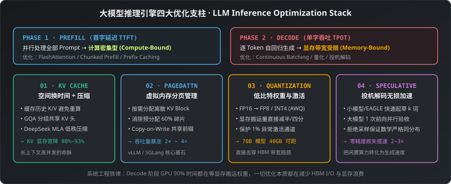


1. **硬件第一性原理**：为什么 Decode 阶段一块价值数万美元的顶级 GPU 算力利用率不到 5%？理解 **Memory-Bandwidth-Bound（显存带宽墙）**。
2. **亲手算出 KV Cache 显存账本**，秒懂 GQA 与 DeepSeek MLA 为何能把长上下文成本打下来一个数量级。
3. **四大推理引擎杀手锏**：PagedAttention、Continuous Batching、AWQ/FP8 量化、以及严格数学无损的 **Speculative Decoding（投机解码）**。




## 1. 硬件真相：Prefill 与 Decode 是两种截然不同的“物种” / The Hardware Truth: Prefill vs. Decode


当你向大模型发出一个请求，GPU 内部其实经历了两个物理特性**完全相反**的阶段：

1. **Prefill（预填充阶段，决定首字延迟 TTFT）**：
   模型一次性并行读取你输入的全部 Prompt（例如 4,096 个 Token），做大规模的矩阵 × 矩阵乘法（GEMM）。此时 GPU 的 Tensor Core 满负荷运转，属于 **Compute-Bound（计算受限）**。
2. **Decode（解码生成阶段，决定吐字速度 TPOT）**：
   模型一个字一个字地自回归吐出回答。每吐 1 个 Token，GPU 都要把**整整几十 GB 的模型权重从 HBM 显存搬进片上缓存算一次矩阵 × 向量乘法（GEMV）**，算完只产出区区 1 个新词！
   - 算力（FLOPs）闲得发慌，**90%+ 的时间全花在等 HBM 显存搬运数据上**！这就是大名鼎鼎的 **Memory-Bandwidth-Bound（显存带宽墙）**。

> **一个算术秒懂极限速度**：假设 70B FP16 模型重 `140 GB`，单卡 HBM 带宽 `3.35 TB/s`。哪怕计算耗时为 0，单请求理论吐字上限也只有 `3350 / 140 ≈ 24 tokens/s`！因此，一切推理优化的本质只有两条路：**① 减少每次搬运的字节数（量化/剪枝/MoE）**；**② 一次搬运多算几个 Token（Continuous Batching / 投机解码）**。



Every LLM request goes through two physically opposite regimes on a GPU:

1. **Prefill (governs TTFT — Time To First Token)**: Processes all prompt tokens in parallel via dense matrix-matrix multiplications (GEMM). Tensor Cores stay saturated → **Compute-Bound**.
2. **Decode (governs TPOT — Time Per Output Token)**: Generates one token at a time via matrix-vector multiplications (GEMV). For *every single token*, the GPU must stream tens of gigabytes of weights from HBM—leaving compute units >90% idle → **Memory-Bandwidth-Bound**.

> **Back-of-the-envelope physics**: A 70B FP16 model weighs `140 GB`. On a `3.35 TB/s` HBM GPU, even with zero compute time, single-stream speed caps out at `3350 / 140 ≈ 24 tokens/s`. Every optimization therefore either **shrinks bytes moved** (quantization, MoE) or **amortizes weight reads over more tokens** (batching, speculative decoding).


## 2. KV Cache 与显存账本：GQA 和 MLA 如何救命？ / KV Cache Math: GQA & MLA


生成第 `t` 个 Token 时，Attention 需要用到前面 `1 ~ t-1` 所有 Token 的 Key 和 Value 向量。如果不缓存，每吐一个词都要把前文重算一遍（复杂度 `O(T²)`）。因此推理引擎会把历史 `K, V` 缓存在显存里——这就是 **KV Cache**。

**KV Cache 到底有多吃显存？直接套公式算：**

> `KV Cache 字节数 = 2 (K和V) × 层数 L × KV头数 n_kv × 单头维度 d_h × 序列长度 S × 并发数 B × 精度字节数 (FP16=2)`

以经典 70B 模型（80 层、隐藏维 8192）为例，如果用传统 MHA（64 个独立 KV 头），**单条 32K 上下文请求的 KV Cache 就要吃掉惊人的 `80 GB`**——连一张 A100 都塞不下 1 个用户！

现代架构的三大破局方案：
- **GQA（Grouped-Query Attention，分组查询注意力）**：让每 8 个 Query 头共享 1 组 KV 头（Llama-3 / Qwen 标配），KV 显存直接暴降 **8 倍**！
- **MLA（Multi-Head Latent Attention，多头潜在注意力）**：DeepSeek-V2/V3 提出的神来之笔——不直接缓存庞大的 K 和 V，而是把它们低秩压缩成一个极小的**联合潜向量 `c_KV`** 存入显存，计算时再通过矩阵吸收技巧动态还原，**将 KV Cache 压缩 90% ~ 93%** 且不掉点！
- **Prefix Caching（前缀缓存 / RadixAttention）**：相同 System Prompt 或同一份长文档的多轮对话直接复用已算好的 KV Cache，首字延迟直降 5~10 倍。



To avoid recomputing historical Keys and Values at every decode step, inference engines cache them in VRAM (**KV Cache**):

> `KV Bytes = 2 × n_layers × n_kv_heads × d_head × seq_len × batch_size × bytes_per_elem`

With classic Multi-Head Attention (MHA), a single 32K-token session on a 70B model would consume **~80 GB of KV Cache alone**. Modern architectures slash this via:
- **GQA (Grouped-Query Attention)**: Multiple query heads share one KV head → **4×–8× smaller KV Cache**.
- **MLA (Multi-Head Latent Attention, DeepSeek)**: Projects K and V into a compact low-rank latent vector `c_KV` cached in VRAM → **90%+ KV Cache reduction** with minimal quality loss.
- **Prefix Caching / RadixAttention**: Reuses precomputed KV blocks for shared system prompts or multi-turn histories across requests.


## 3. PagedAttention 与 Continuous Batching：vLLM 的核心秘密 / PagedAttention & Continuous Batching


即便压缩了 KV Cache，早期推理框架仍会浪费 **60% ~ 80% 的显存**——因为你不知道用户最终会生成 50 字还是 4,096 字，只能提前按最大长度预留一大块**连续显存**，导致严重的内/外部内存碎片。

UC Berkeley 团队在 **vLLM** 中借用了操作系统 50 年前的经典智慧——**虚拟内存分页（Virtual Memory Paging）**，提出 **PagedAttention**：
- 把每个请求的 KV Cache 切分成固定大小的小页块（例如每 Block 存 16 个 Token），**物理上可以离散地塞在显存任意空位里**，用一张极小的 Block Table 维护逻辑顺序。
- 显存利用率瞬间从 **~30% 飙升至 >96%**，还天然支持 Copy-on-Write（多路采样共享同一个 Prompt 块）！

再配合 **Continuous Batching（迭代级连续批处理）**：不用傻等整个 Batch 里最慢的那个长回复结束，只要 Batch 里任意一个请求吐出 `<EOS>` 结束符，下一个迭代（几十毫秒后）立刻把排队的新请求插进去，系统总吞吐量直接翻 **2× ~ 4×**！



Early serving engines pre-allocated contiguous VRAM up to `max_seq_len` per request, wasting **60%–80% of memory** to fragmentation.

**vLLM's PagedAttention** borrows OS virtual memory paging: it splits each request's KV Cache into fixed-size blocks (e.g., 16 tokens/block) stored non-contiguously in VRAM and tracked via a lightweight block table—pushing memory utilization above **96%** and enabling Copy-on-Write prefix sharing.

Paired with **Continuous (Iteration-Level) Batching**—injecting new waiting requests the very instant any active sequence emits `<EOS>`—serving throughput jumps **2×–4×**.


## 4. 量化（Quantization）与投机解码（Speculative Decoding） / Quantization & Speculative Decoding


### 量化：把“砖头”变轻，直接突破显存带宽墙
Decode 阶段既然卡在搬运权重，把权重从 **FP16（16-bit）** 压到 **FP8（8-bit）** 甚至 **INT4（4-bit）**，显存占用和搬运时间就分别减半、四分！
- **FP8（W8A8）**：Hopper / Blackwell 架构原生硬件指令支持，几乎**零精度损失**，当前云端生产集群首选。
- **AWQ（Activation-Aware Weight Quantization, W4A16）**：核心洞见是权重里只有 **~1% 的关键通道（Salient Weights）** 对激活值影响巨大——只要根据校准激活分布对这 1% 通道做缩放保护，就能在 4-bit 下几乎无损运行，让 70B 模型塞进单张 48GB 显卡！

### 投机解码（Speculative Decoding）：免费把闲置算力变成 2~3× 速度
Decode 时 GPU 算 1 个 Token 和并行校验 5 个 Token 花的时间几乎一模一样（都是搬一次权重）！**投机解码**巧妙利用了这一反直觉物理特性：
1. **起草（Draft）**：用一个极小极快的草稿模型（或 EAGLE 轻量预测头）一口气连猜 `K = 5` 个草稿 Token。
2. **并行验收（Verify）**：把这 5 个草稿一次性打包交给大模型，**仅用 1 次前向推理**同时算出大模型在每个位置的真实概率。
3. **拒绝采样（Rejection Sampling）**：逐一核对草稿，蒙对的全部直接采纳（一次吐出 3~5 个字！），第一个没蒙对的位置按残差分布重新采样修正。

最惊艳的是：**数学上严格证明，投机解码输出的概率分布与纯大模型逐字生成 100% 等价——真正做到“零智商折损、速度翻倍”！**



### Quantization: Moving Fewer Bytes Across HBM
Shrinking weights from FP16 to **FP8** (native on Hopper/Blackwell GPUs, virtually lossless) or **4-bit AWQ** (which identifies and protects the ~1% most activation-salient weight channels) directly multiplies memory-bound decode speed while cutting GPU count in half or quarters.

### Speculative Decoding: 2–3× Lossless Speedup
Because verifying `K` candidate tokens in parallel costs almost the same HBM read as generating 1 token:
1. A tiny **Draft model** (or lightweight EAGLE head) rapidly proposes `K` next tokens.
2. The large **Target model** scores all `K` tokens in **one parallel forward pass**.
3. **Modified rejection sampling** accepts the longest matching prefix and corrects the first mismatch—mathematically guaranteed to preserve the **exact output distribution** of the target model with zero quality degradation!


### 动手精算：Python 快速估算任意模型的权重与 KV Cache 显存 / Quick Python VRAM Estimator

```python
def estimate_llm_vram_gb(
    params_b: float,
    weight_bytes: float,       # FP16=2.0, FP8=1.0, INT4=0.5
    n_layers: int,
    n_kv_heads: int,
    d_head: int,
    seq_len: int,
    batch_size: int,
    kv_bytes: float = 2.0,     # FP16=2.0, FP8=1.0
) -> dict:
    weights_gb = params_b * weight_bytes
    kv_gb = (2 * n_layers * n_kv_heads * d_head * seq_len * batch_size * kv_bytes) / (1024**3)
    return {
        "weights_gb": round(weights_gb, 2),
        "kv_cache_gb": round(kv_gb, 2),
        "total_gb": round(weights_gb + kv_gb, 2),
    }

# Example: Llama-3-70B (80 layers, 8 GQA KV heads, d_head=128) at FP8, 16K ctx, batch=16
print(estimate_llm_vram_gb(70, 1.0, 80, 8, 128, seq_len=16384, batch_size=16, kv_bytes=1.0))
```

## 5. 权威延伸阅读 / Further Reading

- 📄 **vLLM / PagedAttention**: [Efficient Memory Management for Large Language Model Serving (Kwon et al.)](https://arxiv.org/abs/2309.06180)
- 📄 **Speculative Decoding**: [Fast Inference from Transformers via Speculative Decoding (Leviathan et al., Google)](https://arxiv.org/abs/2211.17192)
- 📄 **DeepSeek MLA**: [DeepSeek-V2: A Strong, Economical, and Efficient Mixture-of-Experts Language Model](https://arxiv.org/abs/2405.04434)
- 🛠️ **Serving Engines**: [vLLM](https://github.com/vllm-project/vllm) · [SGLang](https://github.com/sgl-project/sglang) — 当今最核心的两大开源推理引擎。
