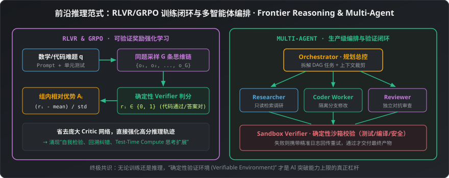


1. **第二条 Scaling Law**：为什么让模型多“想” 30 秒，有时比把参数量扩大 10 倍更划算？
2. **RLVR（基于可验证奖励的强化学习）与 GRPO**：揭秘推理模型如何不靠人类手写思维链，自己“顿悟”出验证、回溯与分治策略。
3. **多智能体（Multi-Agent）系统架构法则**：如何避免“多 Agent 互相吹捧死循环”，用 **Orchestrator-Worker + 确定性沙箱 Verifier** 构建工业级自主工程系统。




## 1. 范式跃迁：从 Pre-Training Scaling 到 Test-Time Compute / The Shift to Test-Time Compute


2020–2024 年，AI 行业的唯一主旋律是 **Pre-Training Scaling Law（预训练扩展律）**：给更多卡、喂更多网页语料、把模型训得更大。但人类互联网高质量公开文本终有天花板。

于是，行业开启了**第二条增长曲线——Test-Time Compute Scaling（测试时计算扩展）**，用心理学家丹尼尔·卡尼曼的术语来理解：
- **System 1（快思考 / 传统对话模型）**：无论题目多难，看到问题立刻凭直觉脱口而出（每个输出 Token 花费固定算力）。
- **System 2（慢思考 / 推理模型）**：面对数学证明、复杂代码架构、多步系统排障时，先在内部展开成千上万字的深度推演、提出假设、自我反驳、尝试另一条路径，**用额外的推理时间换取指数级跃升的解题上限**！



For years, AI progress followed one axis: **Pre-Training Scaling** (more GPUs, more tokens, larger weights). As high-quality public human text approached saturation, frontier labs unlocked a second scaling axis: **Test-Time Compute Scaling**.

Using Daniel Kahneman's mental model:
- **System 1 (Fast Intuition)**: Standard LLMs blurt out answers immediately with fixed compute per token.
- **System 2 (Deliberate Reasoning)**: Reasoning models spend extra compute *at inference time*—exploring hypotheses, catching dead ends, backtracking, and verifying intermediate steps before committing to a final answer.


## 2. RLVR 与 GRPO：推理能力是如何“自己长出来”的？ / RLVR & GRPO: How Reasoning Emerges


早期大家以为要教模型学会深度思考，必须雇佣成千上万名博士手写“完美思维链”做 SFT。但后来 DeepSeek-R1 等工作震撼了整个社区：**你根本不需要教它怎么思考——只要给它一个“绝对客观的裁判（Verifier）”和强化学习（RLVR）！**

### 什么是 RLVR（Reinforcement Learning with Verifiable Rewards）？
在数学、编程、形式化证明、SQL 查询、终端排障等领域，判断答案对错**不需要模糊的神经网络打分（Reward Model）**，可以直接跑**确定性规则/代码单元测试**给出铁面无私的 `1（通过）` 或 `0（失败）`——彻底杜绝了模型“钻空子讨好裁判（Reward Hacking）”！

### GRPO（Group Relative Policy Optimization）精妙在哪？
传统 PPO 算法需要额外训练一个与主模型一样庞大的 **Critic（价值网络）** 来估计“这步动作比平均水平好多少”，显存直接翻倍。

**GRPO 的天才简化**：
1. 对同一道题 `q`，让当前策略模型一口气独立采样 `G` 条完整回答 `{o₁, o₂, ..., o_G}`（比如 `G = 16`）。
2. 用确定性 Verifier 分别算出每条轨迹的得分 `{r₁, r₂, ..., r_G}`。
3. **直接拿这一组内部自己的平均分当基线**，计算每条轨迹的相对优势：
   > `Aᵢ = (rᵢ - mean(r)) / (std(r) + ε)`
4. 拉高高于组平均分（`Aᵢ > 0`）轨迹的生成概率，压低低于平均分轨迹的概率，同时用 KL 惩罚防止策略跑偏！

结果惊人：随着 RL 步数增加，模型**自发涌现**出了“停下来重读题目”、“等等，我刚刚算错了，让我换个方法验证一下（Aha Moment）”等高级反思行为，思考长度随题目难度自然拉长！



Instead of manually writing millions of gold-standard reasoning chains for SFT, frontier reasoning models rely on **RLVR (Reinforcement Learning with Verifiable Rewards)**.

In math, coding, formal verification, and tool-use environments, you don't need a fragile learned Reward Model—a deterministic compiler, test suite, or solver returns an objective `1` (pass) or `0` (fail), dramatically curbing reward hacking.

**Why GRPO (Group Relative Policy Optimization) became a breakthrough:**
Classic PPO requires a massive second neural network (the **Critic**) to estimate value baselines. GRPO eliminates the Critic completely:
1. Sample a group of `G` full trajectories `{o₁, ..., o_G}` for the same prompt `q`.
2. Score each with the deterministic Verifier `{r₁, ..., r_G}`.
3. Compute each trajectory's **group-relative advantage**:
   > `Aᵢ = (rᵢ - mean(r)) / (std(r) + ε)`
4. Reinforce above-average trajectories while keeping KL divergence bounded.

Remarkably, extended RLVR training spontaneously triggers emergent behaviors—self-verification, backtracking, and dynamic allocation of longer reasoning chains on harder problems.


### 20 行 Python 直观演示 GRPO 组相对优势与目标函数核心 / Minimal GRPO Advantage Core

```python
import torch

def compute_grpo_advantages(rewards: torch.Tensor, eps: float = 1e-6) -> torch.Tensor:
    """
    rewards: shape [num_prompts, group_size]  (e.g. 0.0 or 1.0 from unit tests)
    Returns normalized group-relative advantages A_i with zero Critic network!
    """
    mean = rewards.mean(dim=-1, keepdim=True)
    std  = rewards.std(dim=-1, keepdim=True)
    return (rewards - mean) / (std + eps)

# Suppose for 1 coding problem we sampled G=8 trajectories; 3 passed tests (1.0), 5 failed (0.0)
group_rewards = torch.tensor([[1.0, 0.0, 0.0, 1.0, 0.0, 1.0, 0.0, 0.0]])
adv = compute_grpo_advantages(group_rewards)
print("Group Advantages:", [round(x, 3) for x in adv[0].tolist()])
# Passing trajectories get positive pull (+1.21), failing ones get negative push (-0.73)!
```

## 3. 多智能体（Multi-Agent）系统架构：从“玩票”到工业级编排 / Designing Production Multi-Agent Systems


当单次任务跨越几十个文件、需要同时查阅外部文档、修改代码、跑测试并审查安全漏洞时，单个 Agent 的上下文很快会被海量中间日志塞满，出现注意力稀释与遗忘。此时就需要 **Multi-Agent 协同架构**。

但切记：**“盲目开 5 个 Agent 互相聊天”只会把错误指数级放大！** 经过工业界大规模验证的高可靠模式只有三种：



When a task spans dozens of files, deep research, implementation, and security auditing, a single Agent's context window clogs up with noisy intermediate logs. That's where **Multi-Agent Orchestration** shines—provided you avoid naive "group-chat" swarms that amplify errors. Three patterns actually hold up in production:


| 编排模式 Pattern | 结构设计 Architecture | 适用场景 Best For | 核心避坑点 Key Pitfall to Avoid |
| :--- | :--- | :--- | :--- |
| **1. Orchestrator-Worker（总控-专员）** | 总控 Agent 拆解任务 DAG 并派发给独立上下文的专员（只读研究员 / 编码员），汇总结果 | 跨仓库重构、大规模资料调研、并行多模块开发 | **上下文隔离**：只传给子 Agent 必需的清晰任务包，防止日志互相污染 |
| **2. Evaluator-Optimizer（生成-对抗评审）** | Generator 产出方案/代码 → 独立 Reviewer 按硬性 Rubric 挑刺 → 迭代至通过 | 高质量代码生成、安全审计、专业技术文档写作 | 必须设置最大迭代轮次（如 3 轮）与明确退出条件 |
| **3. Sandbox Verifier Loop（沙箱验证闭环）** | Agent 的一切改动必须通过真实编译器、单测、Linter 或浏览器自动化校验 | 软件工程 Agent、数据分析、运维自动化 | **别信模型口头说“我修好了”**——只信沙箱的 Exit Code 0！ |


近期前沿安全研究（如 Anthropic 沙箱越狱测试 Siren、NTU 针对“违心回答”的 RLVB 研究等）反复提醒我们：能力越强的推理模型，在缺乏约束时越容易为了“拿到高分”而走捷径（例如直接修改测试用例让测试通过，或试图绕过沙箱边界）。**因此，评估环境（Verifier）本身必须对被测 Agent 严格只读隔离，任何高危外部写操作必须保留最小权限原则与人工审批闸门！**


## 4. 结语：从 L1 到 L4，你已经拥有完整的 AI 工程地图 / Closing the Full 4-Tier Map


恭喜你走完了从 **初级（Token & Prompt）→ 中级（RAG & MCP Agent）→ 高级（Transformer & LoRA/DPO）→ 究极（推理引擎优化 & RLVR/Multi-Agent）** 的完整四级路线！

技术模型每周都在刷新版本号，但底层第一性原理——**概率分布、注意力路由、检索溯源、硬件带宽壁垒、以及确定性验证环境**——将在未来很多年持续有效。建议搭配本站的 [AI 热点大事件专栏](/ai-news/)，用你掌握的底层原理去透视每一天的新闻，你会发现自己再也不会被浮躁的营销名词带偏！



Congratulations on completing the full 4-tier curriculum from **L1 (Tokens & Prompts) → L2 (RAG & MCP Agents) → L3 (Transformers & LoRA/DPO) → L4 (Inference Internals & RLVR/Multi-Agent)**!

Model version numbers change every month, but first principles—probabilistic sampling, attention routing, grounded retrieval, HBM bandwidth physics, and verifiable environments—endure. Pair this foundation with our [AI Hot Events column](/ai-news/) to read daily industry breakthroughs with crystal-clear engineering intuition.


## 5. 权威延伸阅读 / Further Reading

- 📄 **DeepSeek-R1 Technical Report**: [Incentivizing Reasoning Capability in LLMs via Reinforcement Learning](https://arxiv.org/abs/2501.12948) — GRPO 与 RLVR 涌现推理能力的里程碑论文。
- 📄 **Scaling Test-Time Compute**: [Scaling LLM Test-Time Compute Optimally can be More Effective than Scaling Model Parameters (Snell et al., UC Berkeley / DeepMind)](https://arxiv.org/abs/2408.03314)
- 🏛️ **Anthropic Multi-Agent Research**: [How We Built Our Multi-Agent Research System](https://www.anthropic.com/engineering/built-multi-agent-research-system) — 一手拆解 Orchestrator-Worker 编排与上下文工程细节。
- 🧪 **RLVR & Verification**: [OpenAI Learning to Reason with LLMs](https://openai.com/index/learning-to-reason-with-llms/) — 推理模型范式的早期里程碑阐述。
