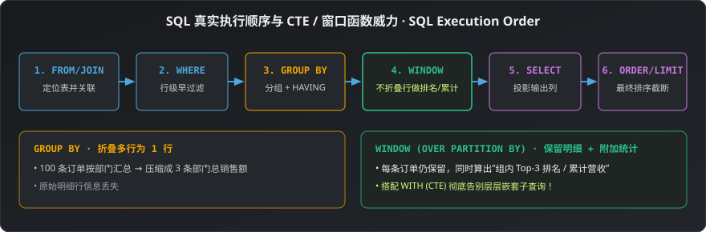


它不只是关系型数据库——它是 **ACID 强一致事务 + JSONB 文档库 + 全文搜索引擎 + `pgvector` AI 向量库** 四合一的瑞士军刀。初创和中型项目选 PG，能少运维三套中间件。




## 1. 一行 Docker 起库 + 建表数据类型避坑表 / 1-Line Setup & Data Type Rules

```bash
# 本地秒起带 pgvector 的 PostgreSQL 17（macOS / Linux / Windows Docker 通用）
docker run -d --name pg-dev -e POSTGRES_PASSWORD=postgres -p 5432:5432 pgvector/pgvector:pg17
```

| 需求 Need | ❌ 别这么用 Avoid | ✅ PG 黄金推荐 Use This | 原因 Why |
| :--- | :--- | :--- | :--- |
| **自增主键** | `SERIAL` / `INT` | **`BIGINT GENERATED ALWAYS AS IDENTITY`** | 符合 SQL 标准，杜绝 21 亿整数溢出灾难 |
| **字符串** | `VARCHAR(255)` | **`TEXT`**（需要限长用 `CHECK` 约束） | PG 中 `TEXT` 与 `VARCHAR` 底层性能完全一致，改长度无需锁表 |
| **时间** | `TIMESTAMP`（无时区） | **`TIMESTAMPTZ`** | 内部统一存 UTC，彻底告别跨时区错乱 8 小时 |
| **金额** | `FLOAT` / `DOUBLE` | **`NUMERIC(12, 2)`** 或存“分”的 `BIGINT` | 杜绝二进制浮点数 `0.1 + 0.2 != 0.3` 账目误差 |
| **灵活扩展字段** | `JSON`（纯文本） | **`JSONB`** | 二进制存储，支持建 GIN 索引与毫秒级局部查询 |

## 2. `WITH` (CTE) + 窗口函数：一行替代层层嵌套子查询 / CTEs & Window Functions


遇到 **“查出每个部门薪资排名前 3 的员工”** 或 **“计算每日订单累计营收与环比增长”** 时，新手常写出套娃三层的自连接子查询；高手只用 **CTE（把复杂逻辑像写代码一样分步命名）+ 窗口函数（不折叠明细行就能做组内排名/累计）**：



Use **CTEs (`WITH`)** to make multi-step SQL read top-to-bottom like clean code, and **Window Functions (`OVER`)** to compute per-group rankings or running totals without collapsing rows:


```sql
-- 实战：一次性算出每个租户销售额 Top-3 订单，并附带该租户内的累计营收
WITH paid_orders AS (
    SELECT
        id,
        tenant_id,
        amount_cents,
        created_at
    FROM orders
    WHERE status = 'paid'
      AND created_at >= NOW() - INTERVAL '30 days'
),
ranked AS (
    SELECT
        *,
        ROW_NUMBER() OVER (PARTITION BY tenant_id ORDER BY amount_cents DESC) AS rn,
        SUM(amount_cents) OVER (PARTITION BY tenant_id ORDER BY created_at)   AS running_total
    FROM paid_orders
)
SELECT id, tenant_id, amount_cents, running_total
FROM ranked
WHERE rn <= 3
ORDER BY tenant_id, rn;
```

## 3. Upsert 神器：`ON CONFLICT DO UPDATE` / Atomic Upsert


告别“先 `SELECT` 再判断 `INSERT` 还是 `UPDATE`”的并发竞态 Bug！PostgreSQL 原生支持原子级 Upsert，一条语句解决幂等写入：



Eliminate race-prone check-then-insert logic with PostgreSQL's atomic `ON CONFLICT` upsert:


```sql
INSERT INTO user_daily_quota (user_id, day, used_tokens)
VALUES (1001, CURRENT_DATE, 1500)
ON CONFLICT (user_id, day)
DO UPDATE SET used_tokens = user_daily_quota.used_tokens + EXCLUDED.used_tokens
RETURNING used_tokens;
```

## 4. 权威参考 / References

- 📘 **PostgreSQL Official Docs**: [Window Functions Tutorial](https://www.postgresql.org/docs/current/tutorial-window.html)
- 🛡️ **PG Wiki**: [Don't Do This (官方避坑清单)](https://wiki.postgresql.org/wiki/Don%27t_Do_This) — 强烈建议每个后端工程师通读一遍！
