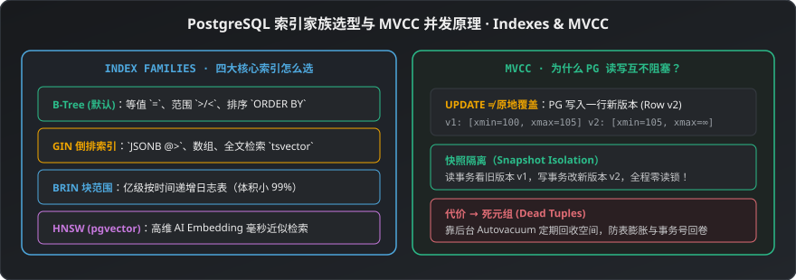


**不要凭感觉加索引！** 每次优化慢 SQL 前，先跑 `EXPLAIN (ANALYZE, BUFFERS)` 看清两件事：① 有没有发生大表全扫（`Seq Scan`）；② 实际读了多少内存页（`shared hit / read`）。




## 1. 组合索引与部分索引：把查询从 1.2 秒降到 0.4 毫秒 / Composite & Partial Indexes


建索引最常见的三个误区，避开就能秒杀 90% 的慢 SQL：
1. **联合索引列顺序口诀：“等值放前面，范围/排序放后面”**。查 `WHERE tenant_id = 5 AND created_at > '2026-11-01' ORDER BY created_at DESC`，索引必须建 `(tenant_id, created_at DESC)`，顺序反了效果暴跌！
2. **善用部分索引（Partial Index）**：如果 99% 的订单都已完成，业务只频繁查 `status = 'pending'`，加个 `WHERE status = 'pending'`，索引体积直接缩小 **99%**、写入几乎零负担！
3. **对索引列套函数会直接让索引失效**：写 `WHERE created_at >= '2026-11-01' AND created_at < '2026-12-01'`，千万别写 `WHERE DATE_TRUNC('month', created_at) = ...`！



Three high-leverage indexing habits solve 90% of slow queries: (1) put equality columns first and range/sort columns last in composite B-Tree indexes, (2) use **Partial Indexes (`WHERE ...`)** to keep hot-subset indexes tiny, and (3) never wrap indexed columns in functions inside `WHERE`.


```sql
-- 1. 联合覆盖索引：等值列 tenant_id 在前，排序列 created_at 在后
CREATE INDEX CONCURRENTLY idx_orders_tenant_time
    ON orders (tenant_id, created_at DESC)
    INCLUDE (amount_cents);  -- INCLUDE 让查询直接走 Index Only Scan，无需回表！

-- 2. 部分索引：只索引待处理订单，体积极小、更新极快
CREATE INDEX CONCURRENTLY idx_orders_pending
    ON orders (created_at)
    WHERE status = 'pending';

-- 3. JSONB 倒排索引：加速 @> 包含查询
CREATE INDEX CONCURRENTLY idx_docs_meta_gin
    ON documents USING GIN (metadata jsonb_path_ops);
```

## 2. 三秒看懂 `EXPLAIN (ANALYZE, BUFFERS)` / Reading `EXPLAIN` in 3 Seconds


执行 `EXPLAIN (ANALYZE, BUFFERS) SELECT ...` 时，只盯紧 4 个关键信号：



Focus on four signals when reading `EXPLAIN (ANALYZE, BUFFERS)` output:


| 信号 Signal | 含义 Meaning | 优化动作 Action |
| :--- | :--- | :--- |
| **`Seq Scan`（大表）** | 全表扫描，扫完几十万行再丢掉 99% | 检查 `WHERE` 过滤条件，补建 B-Tree / GIN 索引 |
| **`Index Only Scan`** | 顶级性能！只读索引页不回堆表 | 用 `INCLUDE (...)` 覆盖查询列即可达成 |
| **`Rows Removed by Filter: 50000`** | 索引没精确覆盖过滤条件，回表白筛了大量行 | 调整联合索引列顺序或补齐过滤列 |
| **`Buffers: shared read=8000`** | 大量冷数据从磁盘读入而非内存缓存 | 减少扫描行数、调大 `shared_buffers` 或优化分页（用游标分页替代大 `OFFSET`） |

## 3. 通俗理解 MVCC 与 Autovacuum / MVCC & Autovacuum Made Simple


为什么 PostgreSQL 高并发读和写互相不卡？因为 **MVCC（多版本并发控制）**：
- 你执行 `UPDATE` 修改一行数据时，PG **不会原地覆盖**，而是把旧行标记“过期事务号 `xmax`”，再插入一行全新的版本。
- 正在执行的慢查询继续安静地读旧版本，新事务读新版本，**读不阻塞写、写不阻塞读**！
- 唯一的代价是旧版本会留下“死元组（Dead Tuples）”。后台的 **Autovacuum** 会自动巡检清理这些死行，把空间标记为可复用——**切记永远不要关闭 Autovacuum**，对高频更新大表可适当调低 `autovacuum_vacuum_scale_factor`（如 `0.05`）让清理更勤快。



In PostgreSQL's **MVCC**, `UPDATE` writes a new row version instead of overwriting in place—so readers never block writers and writers never block readers. Background **Autovacuum** reclaims old dead tuples; never disable it, and tune `autovacuum_vacuum_scale_factor` tighter (e.g., `0.05`) on hot high-churn tables.


## 4. 权威参考 / References

- 🔍 **Use The Index, Luke**: [SQL Indexing Guide for PostgreSQL](https://use-the-index-luke.com/) — 全球公认最强索引图解教程。
- 📊 **explain.dalibo.com**: [PostgreSQL Execution Plan Visualizer](https://explain.dalibo.com/) — 把 `EXPLAIN (ANALYZE, BUFFERS, FORMAT JSON)` 粘贴进去直接看可视化瓶颈图。
