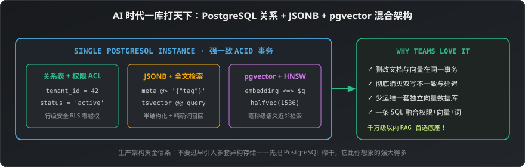


千万级向量以内，**直接用 PostgreSQL + `pgvector`** 往往远胜单独搭一套独立向量库：文档删改和向量更新在**同一个 ACID 事务**里完成，零同步延迟、零权限越权、少运维一套集群！




## 1. 15 行 SQL 搭好生产级 `pgvector` + 全文检索混合知识库 / Hybrid Vector + Full-Text Table


下面这张表同时存了**租户权限（`tenant_id`）、JSONB 扩展元数据、全文检索词条（自动生成列 `fts`）、以及半精度 `halfvec` 向量（显存与磁盘占用直接减半！）**，再配上 `HNSW` 图索引实现毫秒级召回：



Combine relational tenant ACLs, `JSONB` metadata, native `tsvector` full-text search, and compact `halfvec` embeddings with an `HNSW` index inside one ACID table:


```sql
CREATE EXTENSION IF NOT EXISTS vector;

CREATE TABLE kb_chunks (
    id         BIGINT GENERATED ALWAYS AS IDENTITY PRIMARY KEY,
    tenant_id  BIGINT NOT NULL,
    doc_source TEXT NOT NULL,
    content    TEXT NOT NULL,
    metadata   JSONB NOT NULL DEFAULT '{}'::jsonb,
    fts        TSVECTOR GENERATED ALWAYS AS (to_tsvector('simple', content)) STORED,
    embedding  HALFVEC(1536) NOT NULL,  -- 比 float32 vector 省 50% 内存与磁盘！
    created_at TIMESTAMPTZ NOT NULL DEFAULT NOW()
);

-- 1. HNSW 余弦相似度向量索引（检索快、召回高，无需像 IVFFlat 提前训练聚类）
CREATE INDEX idx_kb_embedding_hnsw
    ON kb_chunks USING hnsw (embedding halfvec_cosine_ops)
    WITH (m = 16, ef_construction = 64);

-- 2. 全文检索 GIN 索引 + 租户过滤 B-Tree 索引
CREATE INDEX idx_kb_fts_gin     ON kb_chunks USING gin (fts);
CREATE INDEX idx_kb_tenant_id   ON kb_chunks (tenant_id);
```

## 2. 一条 SQL 实现“权限隔离 + 向量 + 关键词 RRF 混合检索” / Single-SQL Hybrid RAG Search


把 [Python AI 实践 PAI-02](/python-ai-practice/02-build-rag-in-python/) 里的 RRF 混合检索直接下沉进 PostgreSQL——一次网络往返，先按 `tenant_id` 严密隔离权限，再融合语义 Top-20 与关键词 Top-20 返回最终 Top-5：



Push the entire RRF hybrid retrieval (ACL filter + vector + full-text) into a single PostgreSQL round-trip:


```sql
WITH semantic AS (
    SELECT id, ROW_NUMBER() OVER (ORDER BY embedding <=> $1::halfvec) AS rank
    FROM kb_chunks
    WHERE tenant_id = $3
    ORDER BY embedding <=> $1::halfvec
    LIMIT 20
),
lexical AS (
    SELECT id, ROW_NUMBER() OVER (ORDER BY ts_rank_cd(fts, plainto_tsquery('simple', $2)) DESC) AS rank
    FROM kb_chunks
    WHERE tenant_id = $3 AND fts @@ plainto_tsquery('simple', $2)
    LIMIT 20
)
SELECT
    c.id, c.doc_source, c.content,
    COALESCE(1.0 / (60 + s.rank), 0.0) + COALESCE(1.0 / (60 + l.rank), 0.0) AS rrf_score
FROM kb_chunks c
LEFT JOIN semantic s ON c.id = s.id
LEFT JOIN lexical  l ON c.id = l.id
WHERE s.id IS NOT NULL OR l.id IS NOT NULL
ORDER BY rrf_score DESC
LIMIT 5;
```

## 3. PostgreSQL 线上生产保命 4 条铁律 / 4 Production Survival Rules

| 运维要点 Ops Rule | ❌ 事故高发写法 | ✅ 生产保命做法 |
| :--- | :--- | :--- |
| **1. 线上加索引** | 直接 `CREATE INDEX`（锁死整张表写入！） | 永远加 **`CREATE INDEX CONCURRENTLY`**（不阻塞线上读写） |
| **2. 连接数管理** | 200 个微服务进程直接连 PG，打爆内存 | 前端挂 **PgBouncer**（Transaction Pooling 模式），几千并发复用几十条真连接 |
| **3. 慢查询监控** | 出故障才临时翻日志 | 开启 **`pg_stat_statements`** 扩展，按总耗时一键揪出 Top-5 慢 SQL |
| **4. 备份与演练** | 只靠“云厂商应该有快照吧” | 定时 `pg_dump -Fc` + **WAL 归档（PITR 任意秒级恢复）**，每月做一次真实恢复演练 |

## 4. 权威参考 / References

- 🧠 **pgvector Official Repo**: [pgvector — Open-source Vector Similarity Search for Postgres](https://github.com/pgvector/pgvector)
- ⚡ **PgBouncer**: [Lightweight Connection Pooler for PostgreSQL](https://www.pgbouncer.org/)
- 🐘 **PostgreSQL Docs**: [pg_stat_statements](https://www.postgresql.org/docs/current/pgstatstatements.html)
