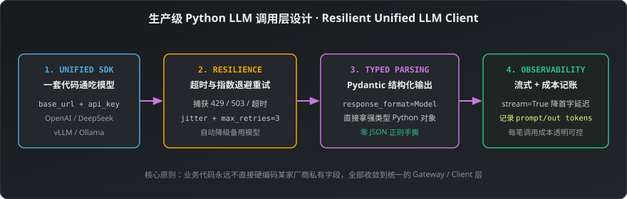


把模型地址（`base_url`）、密钥与模型名全收进环境变量——同一份 Python 代码只需改 3 行 `.env`，就能在 **OpenAI、DeepSeek、Qwen、本地 Ollama、自建 vLLM** 之间零改动无缝切换。




## 1. 强类型结构化抽取：让模型直接返回 Pydantic 对象 / Structured Extraction via Pydantic


告别 `json.loads()` 动不动报错的日子！直接把 Pydantic 模型传给 `client.beta.chat.completions.parse`（或兼容端点的 `response_format`），拿回来就是经过严格字段校验的 Python 对象：



Skip brittle regex JSON parsing—pass a Pydantic schema directly to receive a validated, typed Python object:


```python
# uv add openai pydantic
import os
from typing import Literal
from openai import OpenAI
from pydantic import BaseModel, Field

client = OpenAI(
    api_key=os.environ["LLM_API_KEY"],
    base_url=os.getenv("LLM_BASE_URL", "https://api.openai.com/v1"),
    timeout=30.0,
    max_retries=3,  # SDK 内置指数退避重试 429/5xx
)

class TicketTriage(BaseModel):
    reasoning: str = Field(description="先简要分析用户问题，再给分类")
    category: Literal["billing", "bug", "feature", "other"]
    severity: Literal["P0", "P1", "P2"]
    reply_draft: str

def triage_ticket(user_text: str) -> TicketTriage:
    resp = client.beta.chat.completions.parse(
        model=os.getenv("LLM_MODEL", "gpt-4o-mini"),
        temperature=0.0,
        messages=[
            {"role": "system", "content": "你是工单分诊助手，严格依据原文分类，禁止臆测。"},
            {"role": "user", "content": user_text},
        ],
        response_format=TicketTriage,
    )
    return resp.choices[0].message.parsed
```

## 2. 流式输出（Streaming）+ 精准统计 Token 费用 / Streaming & Usage Tracking


面向终端用户的对话产品，**一定要开 `stream=True`**——模型生成全文可能需要 8 秒，但开流式后 0.4 秒就吐出第一个字，体感速度瞬间提升 10 倍；加上 `stream_options={"include_usage": True}` 还能在最后一片拿到精准 Token 统计用于成本记账：



Always enable `stream=True` for interactive UIs to slash perceived latency, and set `stream_options={"include_usage": True}` to record exact token costs on the final chunk:


```python
def stream_chat(prompt: str) -> tuple[str, dict]:
    chunks: list[str] = []
    usage_info: dict = {}

    stream = client.chat.completions.create(
        model=os.getenv("LLM_MODEL", "gpt-4o-mini"),
        messages=[{"role": "user", "content": prompt}],
        stream=True,
        stream_options={"include_usage": True},
    )
    for event in stream:
        if event.choices and event.choices[0].delta.content:
            token = event.choices[0].delta.content
            print(token, end="", flush=True)
            chunks.append(token)
        if getattr(event, "usage", None):
            usage_info = {
                "prompt_tokens": event.usage.prompt_tokens,
                "completion_tokens": event.usage.completion_tokens,
            }
    print()
    return "".join(chunks), usage_info
```

## 3. 异步高并发批处理：百条数据几秒跑完 / High-Throughput Async Batching


清洗或标注 500 条数据时，换用 `AsyncOpenAI` + `asyncio.Semaphore(10)` 并发限流，比同步 `for` 循环快 **10 倍**且绝不触发接口限频。完整 `asyncio` 限流写法可回看 [PY-02 并发实战](/python-tutorials/02-engineering-uv-async-oop/)。



When processing hundreds of items offline, switch to `AsyncOpenAI` combined with `asyncio.Semaphore(10)` (see [PY-02](/python-tutorials/02-engineering-uv-async-oop/)) for 10× throughput without hitting rate limits.


## 4. 权威参考 / References

- 📘 **OpenAI Python SDK**: [openai-python GitHub](https://github.com/openai/openai-python)
- 🔧 **LiteLLM**: [Unified Proxy for 100+ LLM APIs](https://docs.litellm.ai/)
