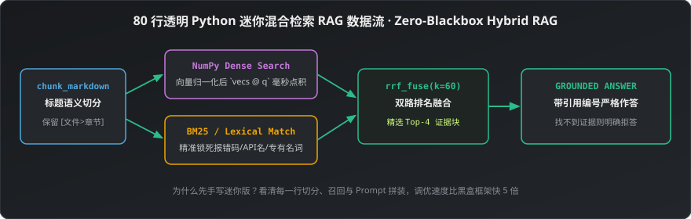


一上来就套 5 层抽象的巨型框架，检索不准时你连“到底切分坏了还是召回坏了”都查不出来。亲手写出这 80 行，你就彻底掌控了 RAG 的全部核心齿轮（理论原理见 [AI 教程 L2-01](/ai-tutorials/l2-01-rag-production-guide/)）。




## 1. 完整可运行核心引擎（切分 + Dense + BM25 + RRF） / Complete Minimal Hybrid Retriever


下面这段代码只依赖 `numpy` 与标准库：
- **切分**：按 Markdown `## ` 章节边界切块，并自动保留章节标题防丢上下文；
- **双路检索**：向量归一化后一行 `self.mat @ q_vec` 算完余弦相似度，同时跑轻量 BM25 词频匹配锁死精确报错码与专有名词；
- **RRF 融合**：用倒数排名融合两路结果，选出最精准的 Top-K 证据块。



Using only `numpy` and the standard library, this engine splits Markdown by section headings, runs dense cosine search (`mat @ q_vec`) alongside lexical BM25, and merges both rankings with Reciprocal Rank Fusion (RRF):


```python
import math, re
from collections import Counter, defaultdict
from dataclasses import dataclass
import numpy as np

@dataclass(slots=True)
class Chunk:
    id: str
    source: str
    text: str

def chunk_markdown(source: str, content: str) -> list[Chunk]:
    """按二级标题切分，保留标题上下文，避免硬切撕裂语义。"""
    parts = re.split(r"(?m)^(?=##\s+)", content.strip())
    return [Chunk(id=f"{source}#{i}", source=source, text=p.strip()) for i, p in enumerate(parts) if p.strip()]

def tokenize(text: str) -> list[str]:
    return re.findall(r"[a-zA-Z0-9_]+|[\u4e00-\u9fff]", text.lower())

class MiniHybridRAG:
    def __init__(self, chunks: list[Chunk], embed_fn) -> None:
        self.chunks = chunks
        self.embed_fn = embed_fn
        # 1. Dense 向量索引（L2 归一化后点积 == 余弦相似度）
        vecs = np.asarray(embed_fn([c.text for c in chunks]), dtype=np.float32)
        self.mat = vecs / np.maximum(np.linalg.norm(vecs, axis=1, keepdims=True), 1e-12)
        # 2. BM25 词频统计
        self.docs_tok = [tokenize(c.text) for c in chunks]
        self.avg_dl = sum(len(t) for t in self.docs_tok) / max(len(self.docs_tok), 1)
        df = Counter(tok for doc in self.docs_tok for tok in set(doc))
        n = len(self.docs_tok)
        self.idf = {t: math.log((n - c + 0.5) / (c + 0.5) + 1.0) for t, c in df.items()}

    def _bm25_rank(self, query: str, k1: float = 1.5, b: float = 0.75) -> list[int]:
        q_toks = tokenize(query)
        scores = []
        for idx, doc in enumerate(self.docs_tok):
            tf = Counter(doc)
            dl = len(doc)
            s = sum(
                self.idf.get(t, 0.0) * (tf[t] * (k1 + 1)) / (tf[t] + k1 * (1 - b + b * dl / self.avg_dl))
                for t in q_toks if t in tf
            )
            scores.append((s, idx))
        return [idx for _, idx in sorted(scores, reverse=True)]

    def search(self, query: str, top_k: int = 4, rrf_k: int = 60) -> list[Chunk]:
        q_vec = np.asarray(self.embed_fn([query])[0], dtype=np.float32)
        q_vec /= max(float(np.linalg.norm(q_vec)), 1e-12)
        dense_order = np.argsort(-(self.mat @ q_vec)).tolist()
        bm25_order = self._bm25_rank(query)

        rrf: dict[int, float] = defaultdict(float)
        for rank, idx in enumerate(dense_order[:20], start=1):
            rrf[idx] += 1.0 / (rrf_k + rank)
        for rank, idx in enumerate(bm25_order[:20], start=1):
            rrf[idx] += 1.0 / (rrf_k + rank)

        best_ids = [idx for idx, _ in sorted(rrf.items(), key=lambda x: x[1], reverse=True)[:top_k]]
        return [self.chunks[i] for i in best_ids]
```

## 2. 拼装防幻觉可溯源 Prompt / Grounded Citation Prompt


拿到 `top_chunks = rag.search(question)` 后，把每段标上 `[1]`、`[2]` 塞进 `<context>`，强制要求模型每条结论必须附引用编号、找不到就明确拒答：



Number every retrieved chunk (`[1]`, `[2]`, ...) inside `<context>` and instruct the LLM to cite sources inline or abstain when evidence is absent:


```python
def build_rag_prompt(question: str, chunks: list[Chunk]) -> str:
    ctx = "\n\n".join(f"[{i}] ({c.source})\n{c.text}" for i, c in enumerate(chunks, start=1))
    return (
        "严格依据 <context> 回答问题，并在关键陈述后标注来源编号如 [1]。\n"
        "如果上下文没有依据，直接回答“知识库中未找到相关信息”，严禁臆测。\n\n"
        f"<context>\n{ctx}\n</context>\n\n<question>{question}</question>"
    )
```


当文档从几千段涨到几十万/百万段时，只需把上面的 `NumPy` 矩阵替换成 **PostgreSQL + `pgvector` (HNSW 索引) + 原生全文检索 `tsvector`**，一行 SQL 同时搞定权限过滤与混合检索！详见 [PostgreSQL 专栏 PG-03](/pg-tutorials/03-pgvector-and-production/)。

