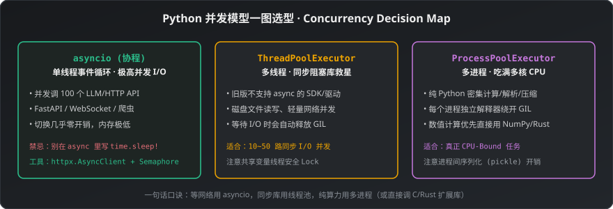


- **环境管理认准 `uv`**：Rust 编写，比 `pip` 快 10~100 倍，一把梭定 Python 版本、虚拟环境与 `uv.lock` 锁文件。
- **并发选型看瓶颈**：调大模型 API / HTTP / 数据库用 `asyncio`；纯 CPU 重计算用多进程或 NumPy/Rust 库。




## 1. 用 `uv` 终结虚拟环境与依赖冲突 / Replace pip/venv with `uv`


过去新手学 Python 80% 的时间都耗在“装包报错、全局 Python 被污染”。现在只需 4 条命令，macOS / Linux / Windows 全平台统一：



`uv` unifies Python version management, virtual environments, dependency resolution, and lockfiles in milliseconds:


```bash
# 1. 初始化现代项目（自动生成 pyproject.toml）
uv init my-service && cd my-service

# 2. 添加运行依赖与开发测试依赖（自动建 .venv 并锁版本）
uv add httpx pydantic fastapi
uv add --dev pytest ruff

# 3. 零激活直接运行脚本与测试
uv run python main.py
uv run pytest -q
```

## 2. 装饰器与上下文管理器：写出优雅复用代码 / Decorators & Context Managers


- **装饰器（Decorator）**：本质就是“接收一个函数、包一层增强逻辑（如计时、重试、鉴权）、再返回新函数”。记得加 `@functools.wraps(fn)` 保留原函数名与文档！
- **上下文管理器（`with`）**：保证无论中途是否抛异常，文件句柄、数据库连接、临时锁都 100% 释放。



Decorators wrap cross-cutting logic (retries, timing, caching) cleanly around functions; `with` context managers guarantee resource cleanup even when exceptions fire:


```python
import time
from functools import wraps
from typing import Callable, TypeVar

T = TypeVar("T")

def timed(fn: Callable[..., T]) -> Callable[..., T]:
    @wraps(fn)
    def wrapper(*args, **kwargs) -> T:
        t0 = time.perf_counter()
        try:
            return fn(*args, **kwargs)
        finally:
            ms = (time.perf_counter() - t0) * 1000
            print(f"[TIMED] {fn.__name__} took {ms:.1f}ms")
    return wrapper

@timed
def compute_sum(n: int) -> int:
    return sum(range(n))
```

## 3. `asyncio` 并发实战：用 `Semaphore` 优雅限流 / Real-World `asyncio` with Concurrency Limits


批量调 50 个外部 API 或大模型接口时，串行要等 50 秒，直接 `asyncio.gather` 一把全发又会把对方打挂触发 `429 Rate Limit`。**生产标准写法永远是 `asyncio.Semaphore` 限流 + `httpx.AsyncClient` 连接复用**：



Never fire 500 unbounded requests with raw `asyncio.gather`. Pair `httpx.AsyncClient` with `asyncio.Semaphore` for fast, rate-limit-safe concurrency:


```python
import asyncio
import httpx

async def fetch_all(urls: list[str], max_concurrency: int = 8) -> list[int]:
    sem = asyncio.Semaphore(max_concurrency)

    async def fetch_one(client: httpx.AsyncClient, url: str) -> int:
        async with sem:
            resp = await client.get(url, timeout=10.0)
            return resp.status_code

    async with httpx.AsyncClient() as client:
        return await asyncio.gather(*(fetch_one(client, u) for u in urls))
```

## 4. `pytest`：5 分钟写出高价值自动化测试 / Minimal, High-Value `pytest`


别写冗长的 `unittest.TestCase` 样板代码！`pytest` 直接写普通函数 + `assert` + `@pytest.mark.parametrize` 覆盖边界条件：



Skip boilerplate `unittest` classes—use plain `assert` statements and `@pytest.mark.parametrize` to test edge cases cleanly:


```python
import pytest

def calc_discount(price: float, rate: float) -> float:
    if not (0 <= rate <= 1):
        raise ValueError("rate must be in [0, 1]")
    return round(price * (1 - rate), 2)

@pytest.mark.parametrize("price,rate,expected", [(100, 0.2, 80.0), (50, 0.0, 50.0)])
def test_discount_ok(price: float, rate: float, expected: float) -> None:
    assert calc_discount(price, rate) == expected

def test_discount_invalid_rate() -> None:
    with pytest.raises(ValueError):
        calc_discount(100, 1.5)
```

## 5. 权威链接 / References

- ⚡ **Astral uv**: [Official uv Documentation](https://docs.astral.sh/uv/)
- 🧪 **pytest**: [pytest Official Documentation](https://docs.pytest.org/)
