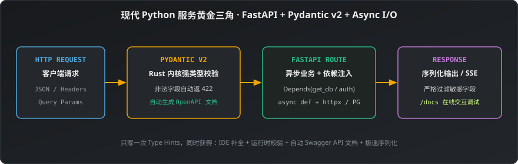


无论是开发 AI 后端服务、内部效率工具，还是写日常批处理脚本，**Pydantic（数据边界）+ FastAPI（HTTP 服务）+ pathlib/httpx（文件与网络自动化）** 可以覆盖 90% 的真实需求，代码量极少却稳如磐石。




## 1. Pydantic v2：把脏数据挡在系统门外 / Pydantic v2: Strict Data Boundaries


Pydantic v2 底层用 Rust 重写，解析速度极快。它在边界处自动做**类型校验、默认值填充、范围约束与 JSON 序列化**——在 AI 开发中更是 **Structured Outputs** 的官方标配：



Powered by a Rust core, Pydantic v2 validates untrusted JSON at system boundaries with clear errors and doubles as the standard schema layer for LLM Structured Outputs:


```python
from pydantic import BaseModel, Field, field_validator

class ArticleInput(BaseModel):
    title: str = Field(min_length=3, max_length=120)
    tags: list[str] = Field(default_factory=list, max_length=5)
    score: float = Field(ge=0.0, le=10.0)

    @field_validator("title")
    @classmethod
    def strip_title(cls, v: str) -> str:
        return v.strip()

item = ArticleInput.model_validate({"title": "  FastAPI 实战  ", "score": 9.5})
print(item.model_dump_json())
```

## 2. 25 行 FastAPI：高性能异步接口 + 自动 Swagger 文档 / 25-Line Production FastAPI


启动后访问 `http://127.0.0.1:8000/docs` 直接送你一套交互式 API 文档，输入格式不对自动返回清晰 `422` 错误详情，彻底告别手写参数校验 `if/else`：



Run `uv run uvicorn app:app --reload` and open `/docs` for instant interactive Swagger UI plus automatic `422` validation errors:


```python
# app.py -> 启动命令: uv run uvicorn app:app --reload
from fastapi import FastAPI, HTTPException
from pydantic import BaseModel, Field

app = FastAPI(title="Mini Note API")
DB: dict[int, dict] = {}

class NoteCreate(BaseModel):
    title: str = Field(min_length=1, max_length=100)
    content: str

class NoteOut(NoteCreate):
    id: int

@app.post("/notes", response_model=NoteOut, status_code=201)
async def create_note(payload: NoteCreate) -> NoteOut:
    note_id = len(DB) + 1
    record = {"id": note_id, **payload.model_dump()}
    DB[note_id] = record
    return NoteOut(**record)

@app.get("/notes/{note_id}", response_model=NoteOut)
async def get_note(note_id: int) -> NoteOut:
    if note_id not in DB:
        raise HTTPException(status_code=404, detail="Note not found")
    return NoteOut(**DB[note_id])
```

## 3. 跨平台自动化脚本铁律：`pathlib` 替代 `os.path` / Cross-Platform Automation with `pathlib`


写批量整理文件、处理 Markdown/CSV 的脚本时，**彻底忘记 `os.path.join` 字符串拼接**！用内置的 `pathlib.Path`，用 `/` 运算符拼路径，macOS、Linux、Windows 全部原生兼容：



Always prefer `pathlib.Path` over legacy `os.path` string manipulation—the `/` operator works identically on macOS, Linux, and Windows:


```python
from pathlib import Path

def count_markdown_words(root_dir: str) -> dict[str, int]:
    root = Path(root_dir)
    stats: dict[str, int] = {}
    for md_file in sorted(root.rglob("*.md")):
        text = md_file.read_text(encoding="utf-8")
        stats[str(md_file.relative_to(root))] = len(text)
    return stats
```


掌握这三篇现代 Python 核心后，立刻前往 [Python AI 实践专栏](/python-ai-practice/)，用你刚学会的 `Pydantic`、`asyncio`、`httpx` 和 `pytest` 亲手写出可落地的 LLM 客户端、混合检索 RAG 与可控 AI Agent！


## 4. 权威链接 / Official Docs

- 🚀 **FastAPI**: [FastAPI Official Tutorial](https://fastapi.tiangolo.com/)
- 🛡️ **Pydantic v2**: [Pydantic Documentation](https://docs.pydantic.dev/latest/)
